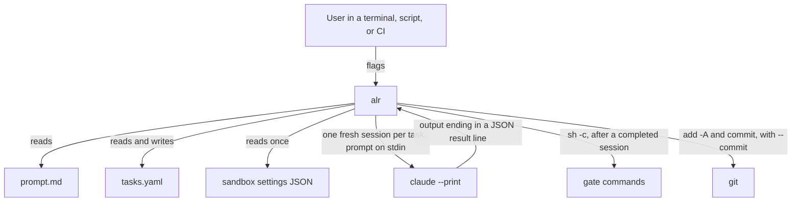

# alr — Architecture Overview

> **Version**: v01
> **Date**: 2026-10-04
> **Notes**: Initial version. Design for porting gralph's engine to Python.

[Back to Project README](../../README.md)

## Table of Contents

- [Introduction](#introduction)
- [Core Concept](#core-concept)
- [System Model](#system-model)
- [Key Principles](#key-principles)
- [Roadmap](#roadmap)
- [Document Navigation](#document-navigation)

## Introduction

`alr` (Agentic Loop Runner) runs "Ralph loops" with Claude Code. It reads a list of tasks from a YAML file and one shared prompt, then works through the list one task at a time, starting a fresh `claude --print` session for each task.

`alr` is the Python port of [gralph](https://github.com/twistingmercury/gralph), which is written in Go. The port exists because the next step for the tool is to grow into a full agent built on a Python framework such as LangGraph or CrewAI. Those frameworks are Python only, so the runner moves to Python first.

This set of documents covers the first step: porting gralph's engine and its plain (no full-screen view) mode. The port is drop-in compatible: an existing gralph task file, prompt, sandbox settings file, and command line work with `alr` unchanged. These documents replace the earlier learning-project requirements in `docs/requirements/01_requirements_v01.md`.

## Core Concept

For each pending task, `alr` joins the shared prompt and the task, hands the text to a new Claude session on stdin, and reads the outcome from the last line of the session's output. A completed task then has the file's gates run and, with `--commit`, is committed. The task file is saved after every task. A failed task stops the run.

## System Model

| Component       | Description                                                                                         |
| --------------- | --------------------------------------------------------------------------------------------------- |
| `alr.cli`       | Parses flags, runs the startup checks, picks the front end, sets the exit code                      |
| `alr.tasks`     | Parses, validates, and atomically saves the task file                                               |
| `alr.engine`    | The shared run logic: the loop, the outcome rule, gates, commits, session flags, process handling   |
| `alr.plain`     | Everything only plain mode does: echo, pass-through output, the dry-run report                      |
| `alr.stream`    | Everything only the full-screen path does: stream-json parsing, events, the run log                 |
| `alr.tui`       | Not in this design. The Textual full-screen view and setup wizard, added by the next design         |

## Key Principles

1. **Drop-in compatible with gralph** — Same flags, task file, result line, behavior, and error text. Existing files and scripts keep working, and gralph's tests become the port's acceptance tests.
2. **One engine, two front ends** — The rules of a run live in one place. Plain mode and the full-screen path differ only in how a subprocess is run and shown, so they cannot disagree on what counts as completed.
3. **The engine never prints and never asks which mode it is in** — It is handed a front end and calls it. This keeps the plain path readable on its own and gives the later TUI and agent layer a clean surface to plug into.
4. **Async from the start** — The engine is built on `asyncio` because the planned TUI (Textual) and agent frameworks are async, and because cancelling a run cleanly is simpler there.
5. **Build only what this step needs** — No agent framework, no TUI library, and no new abstraction beyond the front end interface.

## Roadmap

| Step | Scope                                                                                                      | Status        |
| ---- | ---------------------------------------------------------------------------------------------------------- | ------------- |
| 1    | Engine, plain mode, dry-run, and the stream path plus run log (built and tested, not yet reachable by CLI) | This design   |
| 2    | Textual full-screen view, setup wizard, `--log-dir` switched on, `--install-skill` and the skill check    | Next design   |
| 3    | Single-file input: an optional shared `prompt:` key in the task file, plus other ways to make runs more deterministic | Later         |
| 4    | Agent layer on LangGraph or CrewAI                                                                         | Later         |

## Document Navigation

| #   | Document                                                     | Description                           | Status  |
| --- | ------------------------------------------------------------ | ------------------------------------- | ------- |
| 00  | [Overview](00_overview_v01.md)                               | This document                         | Current |
| 01  | [Requirements](01_requirements_v01.md)                       | Problem statement, goals, constraints | Current |
| 02  | [Architectural Decisions](02_architectural_decisions_v01.md) | ADR log                               | Current |
| 03  | [System Architecture](03_system_architecture_v01.md)         | Components, data flow, boundaries     | Current |

**Next:** [Requirements](01_requirements_v01.md)
