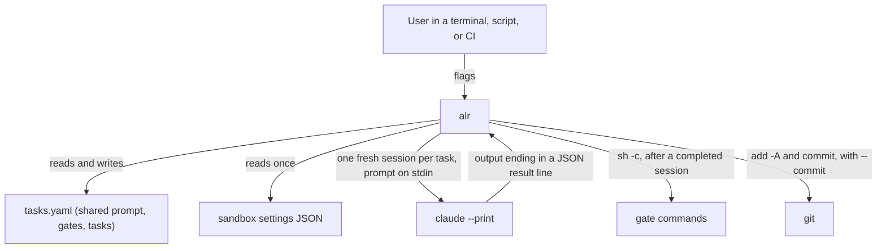

# alr — Architecture Overview

[Back to Project README](../../README.md)

## Table of Contents

- [Introduction](#introduction)
- [Core Concept](#core-concept)
- [System Model](#system-model)
- [Key Principles](#key-principles)
- [Roadmap](#roadmap)
- [Document Navigation](#document-navigation)

## Introduction

`alr` (Agentic Loop Runner) runs "Ralph loops" with Claude Code. It reads one YAML task file holding the shared prompt, the gates, and the list of tasks, then works through the list one task at a time, starting a fresh `claude --print` session for each task.

`alr` is the Python port of [gralph](https://github.com/twistingmercury/gralph), which is written in Go. The port exists because the next step for the tool is to grow into a full agent built on a Python framework such as LangGraph or CrewAI. Those frameworks are Python only, so the runner moves to Python first.

This set of documents covers the first step: porting gralph's engine and its plain (no full-screen view) mode. The port is drop-in compatible: an existing gralph v0.12.0 task file, sandbox settings file, and command line work with `alr` unchanged. These documents replace the earlier learning-project requirements, which are gone from the tree and kept in git history.

## Core Concept

For each pending task, `alr` joins `shared.prompt` and the task, hands the text to a new Claude session on stdin, and reads the outcome from the last line of the session's output. A completed task then has the file's `shared.gates` run and, with `--commit`, is committed. The task file is saved after every task. A failed task stops the run.

## System Model

| Component       | Description                                                                                         |
| --------------- | --------------------------------------------------------------------------------------------------- |
| `alr.cli`       | Parses flags, runs the startup checks, picks the front end, sets the exit code                      |
| `alr.tasks`     | Parses, validates, and atomically saves the task file                                               |
| `alr.engine`    | The shared run logic: the loop, the outcome rule, gates, commits, session flags, process handling   |
| `alr.plain`     | Everything only plain mode does: echo, pass-through output, the dry-run report                      |
| `alr.stream`    | Everything only the full-screen path does: stream-json parsing, events, the run log                 |
| `alr.tui`       | Not in this design. The Textual full-screen view and setup wizard, added by the next design         |

## Key Principles

1. **Drop-in compatible with gralph** — Same flags, task file, result line, and behavior as gralph v0.12.0. Existing files and scripts keep working, and gralph's tests guide the port. Inside, the code is plain Python and does not imitate Go libraries (ADR-007).
2. **One engine, two front ends** — The rules of a run live in one place. Plain mode and the full-screen path differ only in how a subprocess is run and shown, so they cannot disagree on what counts as completed.
3. **The engine never prints and never asks which mode it is in** — It is handed a front end and calls it. This keeps the plain path readable on its own and gives the later TUI and agent layer a clean surface to plug into.
4. **Async from the start** — The engine is built on `asyncio` because the planned TUI (Textual) and agent frameworks are async, and because cancelling a run cleanly is simpler there.
5. **Build only what this step needs** — No agent framework, no TUI library, and no new abstraction beyond the front end interface.

## Roadmap

| Step | Scope                                                                                                      | Status        |
| ---- | ---------------------------------------------------------------------------------------------------------- | ------------- |
| 1    | Engine, plain mode, dry-run, and the stream path plus run log (built and tested, not yet reachable by CLI) | This design   |
| 2    | Textual full-screen view, setup wizard, `--log-dir` switched on, `--install-skill` (gralph no longer checks the installed skill) | Next design   |
| 3    | Other ways to make runs more deterministic (single-file input is done: gralph v0.11.0 moved the prompt into the task file) | Later         |
| 4    | Agent layer on LangGraph or CrewAI                                                                         | Later         |

## Document Navigation

| #   | Document                                                     | Description                           | Status  |
| --- | ------------------------------------------------------------ | ------------------------------------- | ------- |
| 00  | [Overview](00_overview.md)                               | This document                         | Current |
| 01  | [Requirements](01_requirements.md)                       | Problem statement, goals, constraints | Current |
| 02  | [Architectural Decisions](02_architectural_decisions.md) | ADR log                               | Current |
| 03  | [System Architecture](03_system_architecture.md)         | Components, data flow, boundaries     | Current |

**Next:** [Requirements](01_requirements.md)
