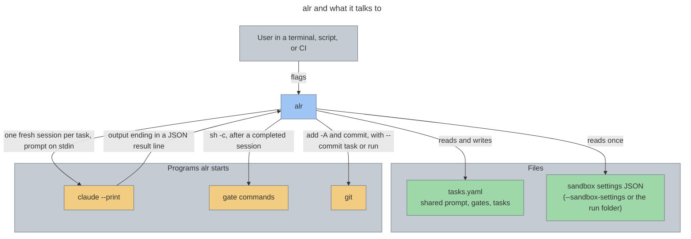

# alr — Architecture Overview

[Back to Project README](../../README.md)

## Table of Contents

- [Introduction](#introduction)
- [Core Concept](#core-concept)
- [System Model](#system-model)
- [Key Principles](#key-principles)
- [Roadmap](#roadmap)
- [Document Navigation](#document-navigation)

## Introduction

`alr` (Agentic Loop Runner) runs "Ralph loops" with Claude Code. It reads one YAML task file holding the shared prompt, the gates, and the list of tasks, then works through the list one task at a time, starting a fresh `claude --print` session for each task.

`alr` began as the Python port of [gralph](https://github.com/twistingmercury/gralph), which is written in Go. The port exists because a separate agent, to be built later as its own program, will use `alr` as a tool: it runs `alr --plain` and reads the exit code and the run log (`<dir>/logs/<timestamp>/run.jsonl` and `task-N.log`). `alr` itself will not embed an agent framework (ADR-022). Python still fits the runner: Textual and asyncio are Python libraries.

This set of documents covers the first two steps. The first ported gralph's engine and its plain (no full-screen view) mode, and is done (v0.0.6). The second adds a Textual full-screen view with setup dialogs, a choice of per-task or after-all commits, and `--install-skill`. The first version was built to match gralph v0.12.0's command line, task file, and behavior. `alr` has since evolved beyond gralph and changes flags, formats, and behavior as its own needs require (ADR-022). These documents replace the earlier learning-project requirements, which are gone from the tree and kept in git history.

## Core Concept

For each pending task, `alr` joins `shared.prompt` and the task, hands the text to a new Claude session on stdin, and reads the outcome from the last line of the session's output. A completed task then has the file's `shared.gates` run and, with `--commit task`, is committed (`--commit run` makes one commit after the last task). The task file is saved after every task. A failed task stops the run.

## System Model

| Component          | Description                                                                                           |
|--------------------|-------------------------------------------------------------------------------------------------------|
| `alr.cli`          | Parses flags, runs the startup checks, picks the front end, sets the exit code                        |
| `alr.tasks`        | Parses, validates, and atomically saves the task file                                                 |
| `alr.engine`       | The shared run logic: the loop, the outcome rule, gates, commits, session flags, process handling     |
| `alr.plain`        | Everything only plain mode does: echo, shown-and-recorded output, the dry-run report                  |
| `alr.record`       | The run events and the run log writer, shared by both front ends                                      |
| `alr.stream`       | Everything only the full-screen path does: stream-json parsing and the stream front end               |
| `alr.tui`          | The Textual full-screen view: the main window, the setup dialogs, the file viewer, and the run worker |
| `alr.skillinstall` | `--install-skill`: copies the bundled skill to `~/.claude/skills`                                     |

## Key Principles

1. **Began as a port of gralph, and has since evolved beyond it** — The port started from gralph v0.12.0's flags, task file, result line, and behavior, and gralph's tests guided it. `alr` now changes flags, formats, and behavior as its own needs require, and the CHANGELOG records each break (ADR-022). Inside, the code is plain Python and does not imitate Go libraries (ADR-007).
2. **One engine, two front ends** — The rules of a run live in one place. Plain mode and the full-screen path differ only in how a subprocess is run and shown, so they cannot disagree on what counts as completed.
3. **The engine never prints and never asks which mode it is in** — It is handed a front end and calls it. This keeps the plain path readable on its own and gives the TUI a clean surface to plug into.
4. **Async from the start** — The engine is built on `asyncio` because the planned TUI (Textual) is async, and because cancelling a run cleanly is simpler there.
5. **Build only what this step needs** — No agent framework, and no new abstraction beyond the front end interface. Textual is the one new dependency.

## Roadmap

| Step | Scope                                                                                                      | Status        |
| ---- | ---------------------------------------------------------------------------------------------------------- | ------------- |
| 1    | Engine, plain mode, dry-run, and the stream path plus run log                                              | Done (v0.0.6) |
| 2    | Textual full-screen view with setup dialogs, after-all commits, logging in both modes, `--install-skill` | Done          |
| 3    | Other ways to make runs more deterministic (single-file input is done: gralph v0.11.0 moved the prompt into the task file) | Later         |
| 4    | A separate agent program that uses `alr` as a tool (ADR-022); not part of `alr`                            | Later         |

## Document Navigation

| #   | Document                                                     | Description                           | Status  |
| --- | ------------------------------------------------------------ | ------------------------------------- | ------- |
| 00  | [Overview](00_overview.md)                               | This document                         | Current |
| 01  | [Requirements](01_requirements.md)                       | Problem statement, goals, constraints | Current |
| 02  | [Architectural Decisions](02_architectural_decisions.md) | ADR log                               | Current |
| 03  | [System Architecture](03_system_architecture.md)         | Components, data flow, boundaries     | Current |

**Next:** [Requirements](01_requirements.md)
