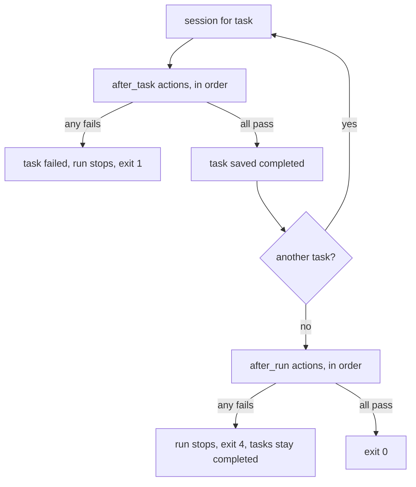

# alr — Architectural Decisions

[Back to Overview](00_overview.md) | [Back to Project README](../../README.md)

## Table of Contents

- [Decision Record Format](#decision-record-format)
- [Decision Summary](#decision-summary)
- [Inherited Decisions](#inherited-decisions)
- [Decisions](#decisions)

## Decision Record Format

Each architectural decision is recorded as an ADR with the following structure:

- **Title**: Short descriptive name for the decision
- **Status**: Proposed | Accepted | Deprecated | Superseded by ADR-NNN
- **Context**: The situation, forces at play, and why a decision is needed
- **Decision**: What was decided and the rationale
- **Consequences**: Both positive outcomes and trade-offs accepted

## Decision Summary

| ADR #                                                                              | Title                                                               | Status   | Date       |
|------------------------------------------------------------------------------------|---------------------------------------------------------------------|----------|------------|
| [001](#adr-001-port-gralph-to-python-drop-in-compatible)                           | Port gralph to Python, drop-in compatible (goal superseded by 022)  | Accepted | 2026-10-04 |
| [002](#adr-002-engine-first-the-tui-is-the-next-design)                            | Engine first; the TUI is the next design                            | Accepted | 2026-10-04 |
| [003](#adr-003-an-async-engine)                                                    | An async engine                                                     | Accepted | 2026-10-04 |
| [004](#adr-004-one-engine-two-front-ends)                                          | One engine, two front ends                                          | Accepted | 2026-10-04 |
| [005](#adr-005-pyyaml-nodes-and-hand-written-validation-no-pydantic)               | PyYAML nodes and hand-written validation, no pydantic               | Accepted | 2026-10-04 |
| [006](#adr-006-port-the-tests-first-with-a-fake-claude-on-path)                    | Port the tests first, with a fake claude on PATH                    | Accepted | 2026-10-04 |
| [007](#adr-007-compatible-in-use-python-native-inside)                             | Compatible in use, Python-native inside (goal superseded by 022)    | Accepted | 2026-10-04 |
| [008](#adr-008-the-shared-prompt-and-gates-live-in-the-task-file)                  | The shared prompt and gates live in the task file                   | Accepted | 2026-10-06 |
| [009](#adr-009-the-run-folders-sandboxjson-answers-the-permission-choice)          | The run folder's sandbox.json answers the permission choice         | Accepted | 2026-10-06 |
| [010](#adr-010-unit-tests-under-make-test-e2e-tests-in-a-container)                | Unit tests under `make test`, e2e tests in a container              | Accepted | 2026-10-06 |
| [011](#adr-011-the-unit-tests-keep-one-case-per-branch)                            | The unit tests keep one case per branch                             | Accepted | 2026-10-06 |
| [012](#adr-012-the-tui-runs-the-engine-in-process-as-a-textual-worker)             | The TUI runs the engine in-process as a Textual worker              | Accepted | 2026-10-07 |
| [013](#adr-013-setup-in-modal-dialogs-over-one-main-window-with-an-explicit-start) | Setup in modal dialogs over one main window, with an explicit Start | Accepted | 2026-10-07 |
| [014](#adr-014-commits-in-the-tui-per-task-or-after-all-tasks-when-there-is-a-work-tree) | Commits in the TUI: per task or after all tasks, when there is a work tree | Superseded by ADR-026 | 2026-10-07 |
| [015](#adr-015-logging-is-a-toggle-on-by-default-the-gate-timeout-has-no-dialog)   | Logging is a toggle, on by default; the gate timeout has no dialog  | Accepted | 2026-10-07 |
| [016](#adr-016---install-skill-installs-the-bundled-skill-and-exits)               | `--install-skill` installs the bundled skill and exits              | Accepted | 2026-10-07 |
| [017](#adr-017-the-task-file-is-always-the-run-folders-tasksyaml)    | The task file is always the run folder's tasks.yaml                | Accepted | 2026-10-07 |
| [018](#adr-018-failed-tasks-are-reset-from-the-menu-or-with---reset-failed)    | Failed tasks are reset from the menu or with --reset-failed         | Accepted | 2026-10-07 |
| [019](#adr-019-the-run-log-always-goes-in-the-run-folders-logs-folder-in-both-modes) | The run log always goes in the run folder's logs folder, in both modes | Accepted | 2026-10-07 |
| [020](#adr-020-the-view-shows-a-ticking-status-line-and-a-time-column) | The view shows a ticking status line and a Time column | Accepted | 2026-10-08 |
| [021](#adr-021-the-bypass-flag-is---yolo) | The bypass flag is `--yolo` | Accepted | 2026-10-08 |
| [022](#adr-022-alr-has-evolved-beyond-gralph) | alr has evolved beyond gralph | Accepted | 2026-10-08 |
| [023](#adr-023-plain-mode-records-gate-git-and-session-stderr-output) | Plain mode records gate, git, and session-stderr output | Accepted | 2026-10-08 |
| [024](#adr-024-one---commit-flag-with-three-modes-none-task-and-run) | One `--commit` flag with three modes: none, task, and run | Superseded by ADR-026 | 2026-10-08 |
| [025](#adr-025-every-outcome-has-an-exit-code-and-a-reason) | Every outcome has an exit code and a reason | Accepted | 2026-10-08 |
| [026](#adr-026-commits-are-actions-the-task-file-has-after_task-and-after_run) | Commits are actions: the task file has `after_task` and `after_run` | Accepted | 2026-10-11 |

## Inherited Decisions

These gralph decisions apply to `alr` unchanged. Their full text is in gralph's
`docs/architecture/02_architectural_decisions.md` at v0.12.0. Where a later gralph ADR amends one of them, the last
column says which `alr` ADR carries the change.

| gralph ADR | Title                                                         | Amended by                       |
|------------|---------------------------------------------------------------|----------------------------------|
| ADR-001    | Claude Code only, no agent abstraction                        |                                  |
| ADR-002    | YAML task file + shared prompt, strict parsing                | ADR-008: one file                |
| ADR-003    | One fresh session per task, no retry                          |                                  |
| ADR-004    | The runner owns task state, atomic writes                     |                                  |
| ADR-005    | Outcome from JSON result line, not exit code                  |                                  |
| ADR-006    | Failed task blocks run until manual reset                     |                                  |
| ADR-007    | Unix only, process group lifecycle management                 |                                  |
| ADR-013    | The runner runs the gates after a completed session           |                                  |
| ADR-014    | Sessions run in Claude Code's sandbox; bypass only on request | ADR-009: found in the run folder; ADR-021: the flag is `--yolo` |
| ADR-015    | The runner commits a completed task on request                |                                  |
| ADR-016    | The runner logs a run on request                              | ADR-008: no `prompt_file`; ADR-019: the ledger and the run folder |
| ADR-019    | One gate list per task file                                   | ADR-008: `shared.gates`          |
| ADR-020    | The shared prompt and gates live in the task file             | ADR-008 is `alr`'s version       |
| ADR-021    | The run folder's sandbox.json answers the permission choice   | ADR-009 is `alr`'s version       |

gralph's ADR-008 (Docker-first CI) is already met by this repository's own build. ADR-009 to ADR-012, ADR-017, and
ADR-018 cover the skill, the TUI, releases, and the wizard, and are left to later designs. gralph's ADR-022 (no check of
the installed skill) supersedes its ADR-010 and needs nothing here: `alr` has no skill check, and the next design's
`--install-skill` will not add one. gralph's ADR-018 is partly ported already: `-d` finds `tasks.yaml` (and, by ADR-009,
`sandbox.json`); the wizard is left to the next design.

## Decisions

### ADR-001: Port gralph to Python, drop-in compatible

[Back to Decision Summary](#decision-summary)

**Status:** Accepted; the drop-in compatibility goal and the plan to grow into an agent are superseded by ADR-022, what the goal covered was narrowed by ADR-007, and
its reference version moves to gralph v0.12.0 under ADR-008 and ADR-009

**Context:**

The runner is meant to grow into a full agent on a Python framework such as LangGraph or CrewAI. gralph is Go. `alr` was
started as a simpler Python runner written by hand as a learning project, with a different task model. Three levels of
faithfulness were considered: drop-in compatible, the same behavior with warts tidied, and a rethink shaped around the
future agent.

**Decision:**

Port gralph to Python in this repository, replacing the existing `alr` code and keeping the name `alr`. The port is
drop-in compatible: same flags, task file format, result line, gates, commit, sandbox behavior, run log, and error text.
gralph at commit `170dc6f` is the behavioral reference. The code is written by Claude and reviewed by the owner; the
earlier rule that the owner writes every line no longer applies.

Tidying was rejected because every tidy-up is a compatibility decision that slows the port. A rethink was rejected
because it has no acceptance tests and guesses at what the agent will need.

**Consequences:**

*Positive:*

- Existing task files, prompts, sandbox settings, and scripts work unchanged
- gralph's unit and e2e tests define done
- The agent work starts from known, tested behavior

*Negative:*

- gralph's quirks come along, including Go-flavored details such as duration syntax and `exit status 1` error text
- The `abandoned` state and the `-d` short form for `--dry-run` from the old `alr` are gone
- Two implementations exist until gralph is retired, and they can drift

### ADR-002: Engine first; the TUI is the next design

[Back to Decision Summary](#decision-summary)

**Status:** Accepted; its plans for an agent layer are superseded by ADR-022

**Context:**

gralph is about 14,700 lines of Go, roughly half tests. It includes a full-screen view and a setup wizard on Bubble Tea.
The owner wants a TUI, and a more capable one than the Go version, because plain command-line use is tedious. Porting
everything at once makes one very large change to review.

**Decision:**

Split the work. This design covers the task file, the engine, plain mode, dry-run, and the engine side of the
full-screen path (stream-json parsing, events, the run log). The Textual view, the wizard, `--install-skill`, and the
skill check are the next design.

Until the view exists, `alr` always runs plain mode: gralph's `--no-tui` flag was accepted and did nothing (it is now
`--plain`, ADR-013). (`--log-dir` was refused on a real run in plain mode until ADR-019 removed it.)

**Consequences:**

*Positive:*

- Each step is small enough to review
- The TUI is designed for Textual's strengths instead of being a line-by-line copy of the Bubble Tea view
- The engine the TUI and the agent build on is finished and tested first

*Negative:*

- The stream path and the run log are built and tested but not reachable from the command line until the next step
- `alr` is not a full replacement for gralph in a terminal until the TUI lands

### ADR-003: An async engine

[Back to Decision Summary](#decision-summary)

**Status:** Accepted; its plans for an agent layer are superseded by ADR-022

**Context:**

The engine runs subprocesses, reads two pipes at once on the stream path, enforces gate timeouts, and must stop cleanly
on a signal. gralph does this with goroutines and context cancellation. In Python the choice is `asyncio` or synchronous
code with threads. The planned TUI library (Textual) is built on `asyncio`, and LangGraph is designed for async use.

**Decision:**

Build the engine on `asyncio`: `asyncio` subprocesses, task cancellation for stopping, and loop signal handlers for
SIGINT and SIGTERM. A synchronous port with reader threads was rejected: it would be simpler to read today, but the TUI
and agent layer would have to run it in a worker thread, and a thread blocked on a subprocess cannot be canceled
without hand-built machinery.

**Consequences:**

*Positive:*

- Textual and an async agent framework can await the engine directly
- Cancellation has one mechanism, with cleanup in one place
- Events are emitted from one thread, so the run log needs no lock

*Negative:*

- `async` and `await` spread through every function that touches the engine
- The code maps less directly onto the Go source
- Tests need pytest-asyncio

### ADR-004: One engine, two front ends

[Back to Decision Summary](#decision-summary)

**Status:** Accepted; its plans for an agent layer are superseded by ADR-022

**Context:**

gralph has two ways to run a task, picked by whether a `report` hook is set. The plain path prints and passes output
through. The stream path captures output and reports events. The choice is checked inside the looper, the gate runner,
and the committer, so plain-only and TUI-only logic are mixed into the same functions. The owner wants a clean, clear
line between what the plain path runs and what the TUI path runs.

**Decision:**

Split the package three ways. `alr.engine` holds the shared rules and never prints. `alr.plain` holds only what plain
mode does. `alr.stream` holds only what the full-screen path does. The engine is handed a front end object and calls it
to run a session, a gate, or a git command and to hear about progress. `alr.cli` picks the front end once.

Import rules, enforced by a test: `engine` imports neither `plain`, `stream`, nor `tui`; `plain` and `stream` do not
import each other.

*Amended by [ADR-019](#adr-019-the-run-log-always-goes-in-the-run-folders-logs-folder-in-both-modes):* the run events
and the run log writer live in `alr.record`, which the plain front end also uses.

**Consequences:**

*Positive:*

- `plain/` can be read top to bottom to see exactly what a no-TUI run does
- The outcome rule, gate rule, commit rule, and save happen in one place, so the two paths cannot drift apart
- The TUI and the agent layer plug in without changing the engine

*Negative:*

- One abstraction, the front end interface, that gralph does not have
- Files do not map one-to-one onto gralph's, so comparing against the Go source takes more care

### ADR-005: PyYAML nodes and hand-written validation, no pydantic

[Back to Decision Summary](#decision-summary)

**Status:** Accepted

**Context:**

gralph validates the task file on raw YAML nodes: it rejects any tag outside the core set, requires `id` to be a real
YAML integer, detects duplicate keys, and reports errors as `tasks[<index>] (id <id>): <field>: <problem>`. The old
`alr` used pydantic models. Matching gralph's rules and exact error text through pydantic means fighting its own error
format.

**Decision:**

Parse with PyYAML's node API (`yaml.compose`), validate with hand-written checks, and hold the result in plain
dataclasses. Remove pydantic. Parse flags with the standard library's `argparse`, with prefix abbreviation turned off.

**Consequences:**

*Positive:*

- Validation rules and error text can match gralph exactly
- One runtime dependency
- The checks port almost directly from `task.go`

*Negative:*

- More validation code than a schema library would need
- `--help` text differs from gralph's

### ADR-006: Port the tests first, with a fake claude on PATH

[Back to Decision Summary](#decision-summary)

**Status:** Accepted; its last sentence is amended by ADR-010, and its port-every-case approach by ADR-011

**Context:**

Drop-in compatibility needs proof. gralph has unit tests per package and a black-box e2e suite that runs the real binary
against a scriptable fake `claude` placed first on `PATH` and driven by `FAKECLAUDE_*` environment variables.

**Decision:**

For each module, port gralph's tests to pytest first, then write the code to pass them. Port the fake `claude` as a
Python script that honors the same environment variables. Port the e2e scenarios as pytest tests that run the installed
`alr` command as a subprocess. The wizard, TUI, install-skill, and skill-check tests are left to the next design. All
tests run under `make test` and inside the Docker build.

**Consequences:**

*Positive:*

- gralph's tests are the definition of compatible
- No real Claude and no network in any test
- The e2e suite exercises the real command line, signals included

*Negative:*

- A large amount of test code to port before features appear
- A gralph test that asserts Go-specific detail needs judgment to translate

### ADR-007: Compatible in use, Python-native inside

[Back to Decision Summary](#decision-summary)

**Status:** Accepted; the compatibility goal described here is superseded by ADR-022

**Context:**

ADR-001 called the port "drop-in compatible" and listed error text among the things that must match. The first five
tasks read that strictly: the task file loader was given a custom YAML resolver so plain values such as `yes` and
`12:30` load the way gralph's Go YAML library loads them, and the saver was taught to quote strings that library would
read as numbers. The owner then clarified the intent. `alr` replaces gralph; the two are not meant to run side by side
on the same files. "Drop-in" was about what a person using the tool sees and types, not about reproducing how the Go
code represents things inside.

**Decision:**

Compatibility covers the surface a user works with:

- The command-line flags and what they mean
- The task file format and its field rules, the shared prompt, and the text sent to Claude
- The result line and the outcome rule
- What gates, `--commit` (now `none`, `task`, or `run`, ADR-024), and the sandbox flags do
- Exit codes and the shape of plain-mode output
- The full-screen view's behavior, when it is built

Compatibility does not cover internal representation:

- YAML is read and written with PyYAML's standard safe loader and dumper rules. A plain value that YAML 1.1 reads as a
  boolean or a number (`yes`, `on`, `12:30`) must be quoted to be a string; `alr` rejects it with a clear message
  otherwise
- Error messages must be clear and name the task and field. They do not have to match gralph's wording, and a ported
  test that asserts Go-specific wording may be adapted
- No new code is added only to imitate a Go library. The `alr.gocompat` module from the first tasks is removed: duration
  parsing and formatting live in `alr.durations` because that is the task file's own format, and the few message helpers
  live where they are used

The saver keeps two behaviors because they serve `alr`'s own users: multi-line text is written as a `|` block, and lists
are indented under their key.

**Consequences:**

*Positive:*

- Less code, and none that exists only to mirror another library
- The task file behaves the way anyone who knows YAML and PyYAML expects

*Negative:*

- A gralph task file with an unquoted name such as `yes` or `12:30` needs quotes added before `alr` accepts it
- Error text can drift from gralph's, so the Go tests are a guide to behavior and no longer an exact oracle for messages

### ADR-008: The shared prompt and gates live in the task file

[Back to Decision Summary](#decision-summary)

**Status:** Accepted

*Amended by [ADR-026](#adr-026-commits-are-actions-the-task-file-has-after_task-and-after_run):* `shared.gates` is now `shared.after_task` and a gate's `cmd` is now `action`; the old names are refused. `shared.after_run` is new.

**Context:**

The first version of these documents read the shared prompt from a second file, `prompt.md`, passed with `-p`, and kept
the gates as a top-level key of the task file. gralph v0.11.0 (its ADR-020) merged them: one `tasks.yaml` holds a
required `shared` block with the `prompt` and the optional `gates`, and `-p/--prompt` is gone. The two files always
traveled together, the skill wrote both in one pass, and every consumer had to find, load, and report two paths. `alr`
follows gralph here because ADR-001 makes gralph the reference. It also settles the "single-file input" step that the
overview's roadmap listed for later.

**Decision:**

The task file has two top-level keys, `shared` and `tasks`, and nothing else.

```yaml
shared:
  prompt: |
    You are working on the widget service...
  gates:
    - cmd: uv run pytest
      timeout: 10m
tasks:
  - id: 1
    name: Add the widget repository
    prompt: |
      Objective: ...
```

- **`shared.prompt` is required.** A missing `shared` block, or a prompt that is missing, not a string, empty, or only
  whitespace, fails parsing. The text is trimmed on load.
- **`shared.gates` is optional, with gralph ADR-019's rules unchanged.** Absent means not decided, `[]` means no gates, and a
  save keeps whichever the file had. Error names read `shared.gates[<j>]`.
- **Unknown keys are errors.** A top-level `gates` key is an error that says gates live under `shared.gates`, as is a
  task-level `gates`. Any other top-level key, and any `shared` key other than `prompt` and `gates`, is rejected too.
  Quietly ignoring an old top-level `gates` list would leave a run with no checks.
- **`-p/--prompt` is removed** with no compatibility path. Passing it is the unknown-flag error.
- **`-d <folder>` means `<folder>/tasks.yaml`.** The "no prompt.md" error goes. `-t` stayed as the override for a folder
  holding two task files (it is gone: ADR-017). A dry run needs nothing the real run does not, so the prompt carve-out goes.
- **The run log drops `prompt_file`** from `run_started`. `tasks_file` stays.
- **The wire contract is unchanged.** Claude gets `shared.prompt`, a blank line, the task text, then a newline. Gates
  and `error` are never sent.
- **A save keeps `shared`.** `shared` is written above `tasks`, with the prompt intact.
- **`PromptError` goes** with the file it described. A bad `shared.prompt` is a `TaskFileError`.

Keeping `-p` as an override was rejected: it keeps the two-file code path this removes, and the project is too young to
need a compatibility path.

**Consequences:**

*Positive:*

- One file is the whole run: prompt, gates, and tasks
- One path to name, load, and report; the `-p` flag and the prompt half of the run log go away
- Room for more shared settings under `shared` without new flags

*Negative:*

- A breaking change for any `tasks.yaml` and `prompt.md` pair from before: they must be merged by hand, and a top-level
  `gates` moved under `shared`
- The shared prompt is YAML now: indentation matters, and it loses Markdown editor support
- A save rewrites the file and does not keep comments or the prompt's own formatting (ADR-005's saver rules)

### ADR-009: The run folder's sandbox.json answers the permission choice

[Back to Decision Summary](#decision-summary)

**Status:** Accepted

**Context:**

gralph v0.12.0 (its ADR-021) lets a run folder carry its own sandbox settings, found by a fixed name as `tasks.yaml` is.
Without it, a run has to repeat `--sandbox-settings <folder>/sandbox.json` even though the file sits beside the task
file. `alr` already has `-d`, so the lookup costs little. The same safety rule as ADR-014 applies: a run never ends up
unsandboxed by accident.

**Decision:**

A `sandbox.json` in a `-d` run folder is the run's `--sandbox-settings`.

- **When it applies.** `-d <folder>` was given, `<folder>/sandbox.json` is a regular file, and neither
  `--sandbox-settings` nor `--skip-permissions` was passed. A directory of that name is ignored. The path is
  `<folder>/sandbox.json` as `-d` was given, not made absolute. Only `-d` looks (there is no `-t` any more: ADR-017).
- **Precedence.** An explicit `--sandbox-settings` wins. An explicit `--skip-permissions` also wins, with no error: it
  is how a run opts out of a folder's sandbox. The "both flags" error is for the two explicit flags only.
- **It never leads to an unsandboxed run.** It only supplies the sandboxed choice. With no file, nothing changes: a real
  run still exits 1 with the neither-flag error. A found file that is unreadable or not a JSON object fails through the
  existing validation, exit 1, and never falls back to going without a sandbox.
- **Plain output.** Nothing new is printed. `--dry-run -d <folder>` names and validates the file on its existing
  `sandbox settings:` line.
- **Startup order.** The file is resolved with the task file, in the `--dir` step, so every later check sees the final
  value.

**Consequences:**

*Positive:*

- `alr -d .local/feat --commit task` is a whole command for a folder that holds its task file and sandbox settings
- A command that names the folder reproduces the run

*Negative:*

- A settings file in a run folder is applied without being named on the command line, so it is as trusted as the
  folder's `tasks.yaml`, which is already code the run executes
- The only way to run a folder that holds a `sandbox.json` unsandboxed is `--skip-permissions`

*Amended by [ADR-021](#adr-021-the-bypass-flag-is---yolo):* `--skip-permissions` is now `--yolo`, with no alias. Read
`--skip-permissions` above as `--yolo`; the rules are unchanged.

### ADR-010: Unit tests under `make test`, e2e tests in a container

[Back to Decision Summary](#decision-summary)

**Status:** Accepted

**Context:**

ADR-006 put every test under `make test` and inside the Docker build, with the e2e tests running the installed `alr`
command. In practice the e2e tests shared helpers and fixtures with the unit tests, so they could pass against code a
user never installs, and they ran against the working tree rather than the built wheel.

**Decision:**

Split the suites so they share nothing.

- `tests/unit/` has its own conftest, helpers, and fake `claude`. `make test` runs the ruff format and lint steps, then
  `pytest tests/unit`. The Docker build runs the unit tests only.
- `tests/e2e/` has its own conftest, helpers, requirements, `pytest.ini`, and fake `claude`. It finds `alr` on `PATH`
  and runs the real command as a subprocess. It never imports from `src/`.
- The e2e suite runs in a container (`tests/e2e/Dockerfile`, started by `tests/docker-compose.yaml`) against the wheel
  installed from `dist/`. `make e2e` runs it against the wheel already in `dist/`, and `make build` builds the wheel and
  then runs it. `build/build.sh` drives both.

This amends ADR-006's last sentence only: the tests are still ported first, the fake `claude` is still driven by
`FAKECLAUDE_*` variables, and no test needs a real Claude or the network.

**Consequences:**

*Positive:*

- The e2e tests check what a user installs, not the working tree
- A helper fixed for one suite cannot quietly make the other pass
- `make test` is fast, with no Docker needed

*Negative:*

- A little test code is duplicated between the suites: the fake `claude` exists twice
- The e2e suite needs Docker and a built wheel, so it does not run under plain `make test`

### ADR-011: The unit tests keep one case per branch

[Back to Decision Summary](#decision-summary)

**Status:** Accepted

**Context:**

ADR-006 ported gralph's tests case by case. By the time the stream path was built, the unit suite held 608 tests: 274
test functions and 334 rows in parametrized tables. A review of the suite found about 180 of them redundant. It judged
each one two ways: breaking the source on purpose and seeing whether a test noticed, and comparing branch coverage with
and without the test. The redundant ones fell into four groups:

- Table rows that push different bad values through one branch, so one row proves the rule as well as ten.
- Tests of the fake `claude` on their own, which the tests that rely on it already prove.
- Tests of constants and of helpers a refactor should be free to change.
- About 40 tests that pinned exact error wording or the operating system's own message text, which ADR-007 does not
  require and which differs between Linux and macOS.

They cost upkeep, and the count made the suite look more thorough than it was.

**Decision:**

The unit suite keeps one case per distinct branch or user-visible rule, not one per ported gralph case.

- A test or row earns its place if removing it loses a branch (checked with branch coverage) or lets a deliberate bug
  survive. It is not enough that it reads as a duplicate: the review found three tests it wrongly called duplicates, and
  branch coverage caught each.
- A test asserts the exception type and the field, flag, task, or path the message must name. It does not assert the
  full sentence, hints, or operating system text.
- The fake `claude` is tested through the code that uses it. A test of the fake itself stays only for behavior no other
  test exercises.
- A test written for a real bug stays, with a name or comment that says which bug. Tests that look like duplicates but
  guard such a bug (the process tests for a descendant that holds a pipe open) are judged by re-breaking the fix, not by
  reading.
- A prune is checked by comparing branch coverage of the whole suite before and after, and by a set of deliberate bugs.
  Reading alone is not enough.

This amends ADR-006: gralph's tests still guide the port and define what a user sees, but they are not copied row for
row. It does not change ADR-010: the e2e suite stays black-box and separate.

**Consequences:**

*Positive:*

- A smaller, faster suite that is cheaper to change and does not break on rewording a message
- A test count that says more about what is covered
- A way to check any future prune that does not depend on judgment

*Negative:*

- Less direct traceability from a `alr` test to the gralph test it came from
- Branch coverage does not prove two inputs expose the same bug: an input that reaches an existing branch can still
  reveal a different fault (a byte order mark in a settings file is one), so such a case needs its own row
- A few small checks, such as the leading whitespace of the first line of a gate command, are no longer pinned

### ADR-012: The TUI runs the engine in-process as a Textual worker

[Back to Decision Summary](#decision-summary)

**Status:** Accepted; its plans for an agent layer are superseded by ADR-022

**Context:**

Step 2 adds a full-screen view. The engine is `asyncio`, Textual runs on `asyncio`, and the stream front end already
reports each run event to a `report` callback. The view has to start a run, show it live, and stop it. Three ways to
host the engine were weighed: an async worker in the app's own event loop, the engine as a child process printing JSON
lines, and the engine in a separate thread.

**Decision:**

Run the engine as an async Textual worker in the app's own event loop.

- An adapter in `alr.tui` is the `report` callback. It turns each `alr.stream.events` value into a Textual message. It
  holds only the function that posts messages, never the app or a widget, so the engine's front end cannot pin the app
  in memory.
- Each pane listens for those messages and knows nothing about the engine.
- **Stop** and Ctrl-C both cancel the worker. Textual receives Ctrl-C as a key press, so the app binds it to Stop. The
  engine's cancel path reports `RunDone` with an error, and a clean finish reports `None`. The app decides the outcome
  from `RunDone.error` and its own stop flag: a run the user stopped is "stopped", any other error is "failed", and
  `None` is "done". The text of a cancelled run's error varies (`task 1: name: stopped`, or a bare `stopped` between
  tasks), so it is never matched. SIGTERM also stops the run.
- During a run the only control is Stop. Pause, skip, and retry would change how the engine records task state, so they
  are left for a later design.

**Consequences:**

*Positive:*

- The least new code: the events and the stream front end already exist
- One event loop, so the engine's process handling and cancellation behave as they do in plain mode
- The same adapter can feed the agent layer later

*Negative:*

- Ctrl-C needs a binding, and the cancel path needs a test under Textual's own input handling
- A bug that blocks the event loop freezes the screen, as it would any Textual app
- No pause, skip, or retry yet

### ADR-013: Setup in modal dialogs over one main window, with an explicit Start

[Back to Decision Summary](#decision-summary)

**Status:** Accepted

**Context:**

Gralph's setup wizard is a separate sequence of full-screen steps (its ADR-018 and ADR-021). The wanted view is one
window that is always there, with the setup as pop-ups, and a run that begins only when the user presses Start.

**Decision:**

One main window and modal dialogs on top of it.

- **Layout.** A labelled settings strip reading `Commit: [none ▾]  Permissions: skip  Logging: [on ▾]  (s)tart`:
  the Commit and Logging controls are dropdowns, and both lock once Start is pressed and stay locked after the run
  (the Commit dropdown offers none, per task, and after all, and starts from `--commit`, ADR-024; outside a git work tree
  its note shows when a mode other than none is chosen). The reason Start is disabled has its
  own row beneath. Under it is a menu row of flat, one-row buttons that carry their hotkeys in their names, `(f)older
  (p)ermissions (g)ates (r)eset (t)asks sandbo(x) (q)uit`, since Textual has no menu-bar widget; there is no footer. Then
  come three titled panes: Tasks (3fr) and Gates & commits (2fr) side by side in a top row of about 40% of the height,
  and Task (the activity pane) across the full width below, about 60%. Long task names end in an ellipsis, and the tasks pane scrolls
  and keeps the running task visible. A status bar closes the screen. The layout fits 80x24 and 110x32.
- **Activity pane.** It shows the lines of one task and follows the running task: when a task starts, the tasks pane
  moves its highlight to that row and the activity pane clears and shows that task's lines. The arrow keys can
  highlight another task to read its lines (every task's last 5,000 lines are kept); the next task start moves the highlight
  again. The title names the task, `Task: 3 Add the folder dialog`. Long lines wrap, print raw (no markup), and are
  redrawn from the kept raw lines when the pane is resized. Each task keeps only its last 5,000 lines in the pane;
  older ones drop without a notice, while the run log keeps every line.
- **Elapsed times.** The summary pop-up, the status line, and the gate times show elapsed time with
  `format_elapsed`: one decimal under a minute (`12.3s`), then whole seconds with the leading zero units dropped
  (`1m 30s`, `1h 2m 3s`, `2h 0m 0s`). The run log's ledger keeps its own format.
- **Keyboard only.** The view is driven entirely from the keyboard and never captures the mouse (`App.run(mouse=False)`),
  so the terminal's own selection, copy, and scroll work. `s` starts a run, Ctrl-C stops it, `q` quits, and `f`, `p`, `g`, `t`, `x` open the Folder, Permissions, and Gates dialogs and the `tasks.yaml` and `sandbox.json` viewers. Esc cancels any dialog, and Enter in a text
  field submits it. The menu buttons are a visual menu: Tab and Enter work on them too. The command palette is turned
  off, so Ctrl-P does nothing.
- **States.** Setup (something is missing, Start disabled with the reason shown), Ready, Running (the Start button
  reads `Stop (^c)` and does what Ctrl-C does; the dropdowns are locked; the Folder, Permissions, Reset, and Quit
  buttons are greyed out and cannot take focus), and Finished (a summary pop-up with the outcome and time, then
  the app stays open until quit; Start is disabled again, Quit is enabled, and Folder, Permissions, and Reset stay
  disabled). The Gates, Tasks, and Sandbox buttons are never changed by a run. There is no second run in the same session.
- **When dialogs open.** At launch, only for a step the flags and the task file leave open: folder, permissions, then
  gates. A folder given on the command line, a folder `sandbox.json`, or a task file with `shared.gates` each hides its
  step. If nothing is open, the app starts in Ready. Until Start, any dialog can be reopened from the menu.
- **Folder dialog.** A folder picker that starts in the working directory and shows hidden entries. It checks the answer
  with the functions a run uses: it loads `tasks.yaml`. A folder outside a git work tree is accepted: the run then makes no
  commits (ADR-014). The error for a bad answer shows in the dialog.
- **Permissions.** Sandbox or skip. A folder `sandbox.json` makes sandbox the default. With no such file nothing is
  pre-selected and Start stays disabled until a settings file is picked or skip is chosen, so nobody runs unsandboxed by
  accident (gralph ADR-014). An explicit skip wins over the folder file (ADR-009).
- **Gates dialog.** Add and remove the shared gates, each a command and an optional timeout; a gate is changed by
  removing it and adding it again. Done with no gates is a decision that there are none.
- **File viewer.** The menu opens `tasks.yaml` or `sandbox.json` read-only, at any time. Once Start is pressed the
  Folder, Permissions, and Gates buttons do nothing. Gates is not greyed out like the others, so pressing it (or `g`)
  during a run simply does nothing; the Tasks and Sandbox viewers still open any time.
- **Nothing is written before Start.** Gate edits stay in memory. Start runs the usual startup checks, and the gates are
  saved to `tasks.yaml` only if they pass. The one exception is resetting failed tasks, which the user asks for
  (ADR-018). The dialogs fill the same values the flags fill, and the startup checks run
  again on those values.
- **When the view is used.** `alr` opens the TUI when stdin and stdout are terminals, `--plain` is absent, and the run
  is not a `--dry-run`. Otherwise, it runs plain mode, as before.

**Consequences:**

*Positive:*

- Nothing starts by accident, and the settings are visible together
- A typo in a gate or a wrong folder is fixed without restarting
- The dialogs reuse the run's own checks, so the view cannot accept what a run would refuse

*Negative:*

- A new third-party dependency, Textual, to track and scan
- A second run needs a relaunch
- A folder that holds a `sandbox.json` can still be run unsandboxed from the permissions setting, by an explicit choice
- Nothing in the view can be clicked: every action needs its key, so the menu names have to keep showing them

### ADR-014: Commits in the TUI: per task or after all tasks, when there is a work tree

[Back to Decision Summary](#decision-summary)

**Status:** Superseded by ADR-026. (Before that, ADR-024 amended the flags and the view's setting: `--commit {none,task,run}` replaced `--commit` and `--commit-after-all`, and the view's Commit dropdown gained none, the default.) The text below is kept as it was.

**Context:**

The engine commits per task when `--commit` is passed, and not at all otherwise. The wanted view commits whenever it
can, and offers a choice of one commit per task or one commit when every task is done. The second mode does not exist.
Requiring a git repository for the view would be too limiting, and plain mode already runs without commits when
`--commit` is passed outside one.

**Decision:**

Add an engine commit mode, `per_task` (the existing behavior) or `after_all`. (ADR-024 renames them `task` and `run` and adds `none`.)

- **After all.** Each task still runs its session and gates as before. When the last task has completed, the engine runs
  `git add -A` and one `git commit`, with the first line `alr: <n> tasks completed` (`alr: 1 task completed` for one task) and a body listing `<id>: <name>`
  for each task. A failed or stopped run makes no commit, so the work stays in the tree.
- **Same checks.** The startup checks are the ones `--commit` has: a clean work tree, and a task file that is ignored or
  outside the repository.
- **Flags.** `--commit` keeps its meaning, one commit per task. A new `--commit-after-all` asks for the second mode.
  Passing both is a usage error. Plain mode accepts both, since the engine is shared. (Amended by ADR-024: one
  `--commit {none,task,run}` replaces both flags, with no alias for `--commit-after-all`.)
- **In the TUI** the commit setting is a choice of the two modes, per task by default, with no way to turn commits off
  while there is a work tree. A passed flag pre-selects its mode. (Amended by ADR-024: the dropdown also offers none,
  and none is the default.)
- **No work tree.** When the working directory is not inside a git work tree there is nothing to commit to. The setting
  is disabled with the note "no git repository: nothing will be committed", and the run makes no commits, as plain mode
  does with `--commit` outside a repository. (Amended by ADR-024: the setting is not disabled. The dropdown stays usable,
  the note shows only when a mode other than none is chosen, and with none the view never looks for a work tree.)

**Consequences:**

*Positive:*

- One commit per feature is possible without squashing afterward
- `--commit` and every command line that uses it behave as before (Amended by ADR-024: a bare `--commit` is now a usage
  error, and `--commit task` is the old `--commit`.)

*Negative:*

- After a failed or stopped run, the completed tasks' work is uncommitted, and the dirty-tree check blocks the next
  start until it is committed or discarded
- Outside a git work tree the view runs but commits nothing, so the changes stay in the folder; only the note beside the
  commit setting says so (Amended by ADR-024: with the default none there is no note at all, and the note shows only
  when a mode other than none is chosen)
- Resuming an after-all run after committing the earlier work by hand gives a commit title with a smaller `n` and a
  body that lists only the tasks that ran in the resumed session

### ADR-015: Logging is a toggle, on by default; the gate timeout has no dialog

[Back to Decision Summary](#decision-summary)

**Status:** Accepted

*Amended by [ADR-026](#adr-026-commits-are-actions-the-task-file-has-after_task-and-after_run):* the gate timeout is now the action timeout: `--gate-timeout` is `--action-timeout`, and it applies to both action lists.

**Context:**

Gralph asks about logging and about a default gate timeout
as wizard steps. Since the TUI could commit whenever it was inside a work tree (ADR-014; ADR-024 later made none the default), a log folder inside the repository would dirty the
tree unless it is git-ignored.

**Decision:**

- **Logging.** A dropdown in the settings strip (`on` or `off`), on by default, writing the run log to `<folder>/logs`. There is no
  `--log-dir` ([ADR-019](#adr-019-the-run-log-always-goes-in-the-run-folders-logs-folder-in-both-modes)). Inside a work
  tree, Start is blocked, with the line to add to `.gitignore`, when the log folder is not ignored; outside one there is
  nothing to ignore. Plain mode always logs (ADR-019); the setting stays in the view.
- **Gate timeout.** No dialog and no setting. Each gate keeps its own optional timeout, edited in the Gates dialog, and
  the 10-minute default covers the rest. `--gate-timeout` still works when passed.

**Consequences:**

*Positive:*

- A finished run can be looked at again through its logs
- The strip and the dialogs stay small

*Negative:*

- A folder that is not ready for logs needs a `.gitignore` edit before the first run, or the Logging setting off
- Setting one default timeout for every gate needs the flag, or editing each gate

### ADR-016: `--install-skill` installs the bundled skill and exits

[Back to Decision Summary](#decision-summary)

**Status:** Accepted

**Context:**

Gralph v0.12.0 has `--install-skill`, which copies its embedded `gralph-docs-writer` skill into `~/.claude/skills/`. It
no longer checks the install afterward (gralph ADR-022). `alr` reads the same `tasks.yaml`, so the same skill applies.

**Decision:**

- `alr --install-skill` copies the bundled `gralph-docs-writer` skill folder (taken from gralph v0.12.0) to
  `~/.claude/skills/gralph-docs-writer/`, replacing any existing copy, prints the path, and exits 0. It runs before the
  other startup checks and opens no screen. An error finding the home folder or writing the files exits 1.
- The skill ships as package data inside the wheel.
- Nothing compares the installed copy with the bundled one later, so a missing or edited skill never stops a run.

**Consequences:**

*Positive:*

- One command sets up the helper that writes task files
- The behavior matches gralph v0.12.0

*Negative:*

- The bundled copy has to be refreshed by hand when gralph's skill changes
- An installed skill can go stale without any warning

### ADR-017: The task file is always the run folder's tasks.yaml

[Back to Decision Summary](#decision-summary)

**Status:** Accepted

**Context:**

`-t/--tasks` named a task file anywhere, while `-d/--dir` already names the run folder that holds `tasks.yaml`, an
optional `sandbox.json`, and now the run log. Two ways to name one input let a task file and its siblings drift apart,
and the full-screen view already asks for a folder rather than a file.

**Decision:**

Remove `-t/--tasks`. The task file is always `<folder>/tasks.yaml`, and `-d/--dir` is the only way to name it on the
command line.

- **Plain mode and the dry run** require `--dir`: without it the command prints `error: required flag --dir not set`
  and exits 1.
- **The full-screen view** asks for the folder in its folder dialog when `--dir` is absent.
- **`-t` and `--tasks`** are unknown-flag errors, with no alias.
- **The folder's `sandbox.json`** is always considered when no permission flag is passed, and the log folder default
  `<folder>/logs` always sits beside the task file.

This amends gralph's ADR-018 and ADR-020 (`-t` as the override) as carried by ADR-008, and ADR-009's "only `-d`
looks".

**Consequences:**

*Positive:*

- One way to name the task file, and its sandbox settings and logs always sit beside it
- Less to explain and to test

*Negative:*

- Gralph command lines that use `-t` stop working, which relaxes the drop-in goal of ADR-007 for this one flag (ADR-022);
  the CHANGELOG records the break
- A folder holding two task files needs two folders

### ADR-018: Failed tasks are reset from the menu or with --reset-failed

[Back to Decision Summary](#decision-summary)

**Status:** Accepted

**Context:**

A run refuses to start while the task file holds a failed task (gralph ADR-002 as carried here). The way out is to fix
the cause and set the task's `state` back to `pending` by hand in the file. The full-screen view could not even open
such a file: the folder dialog rejected it and the tasks pane stayed empty. The wanted behavior is a reset the user can
do from the view, and a flag that does it without asking.

**Decision:**

- **Engine.** `read_tasks` reads and validates the task file without refusing failed tasks; `load_tasks` is
  `read_tasks` plus the refusal, so a run behaves as before. `reset_failed` sets every failed task back to `pending`,
  clears its `error`, saves the file atomically only when something changed, and returns how many it reset. Completed and
  pending tasks are left alone.
- **The view opens a file with failed tasks.** The tasks pane shows them with a cross, and Start stays disabled with the
  reason "N failed tasks: press r to reset".
- **Reset menu item.** `r` (and a Reset item in the menu) opens a pop-up that lists the failed tasks and asks to reset
  them: Enter confirms, Esc cancels. On confirm the file is saved with the tasks reset and the view refreshes. It does
  nothing when no task has failed, and while a run is going or finished.
- **`--reset-failed`.** The same reset without asking, in plain mode and in the view: it runs when the task file is first
  read, before the failed-task check, and prints nothing. It cannot be combined with `--dry-run`, which writes nothing.
- **An exception to "nothing is written before Start" (ADR-013).** A confirmed Reset and `--reset-failed` write
  `tasks.yaml` at once. Gate edits stay in memory until Start.

**Consequences:**

*Positive:*

- A failed run is recoverable from the view without editing the file by hand
- The flag makes scripted retries a one-liner

*Negative:*

- The reset discards the failed task's error text, so the reason for the failure is gone from the file
- A task that fails for the same reason each time is reset each time without a word when `--reset-failed` is used
- Reset writes the task file before Start, which is the one exception to ADR-013's rule

### ADR-019: The run log always goes in the run folder's logs folder, in both modes

[Back to Decision Summary](#decision-summary)

**Status:** Accepted

*Amended by [ADR-026](#adr-026-commits-are-actions-the-task-file-has-after_task-and-after_run):* the run log has no `commit` field, no `committed` event, and no `commit_failed` result; `gate_finished` is now `action_finished` and `gate_timeout` is `action_timeout`; `run_failed` is a new result.

**Context:**

`--log-dir` only worked with the full-screen view, and plain mode refused it. A run that an agent or script drives is
plain mode, so it had no record to read afterwards. Two ways to name the log folder (the flag, the view's default) also
meant two sets of rules.

**Decision:**

- **No `--log-dir`.** The flag is removed; passing it is an unknown-flag error, like `-t` and `--no-tui`.
- **One place.** Both modes write to `<dir>/logs/<YYYYMMDDTHHMMSS>/`, where `<dir>` is the folder that holds
  `tasks.yaml`.
- **Plain mode always logs.** There is no way to turn it off. The view keeps its Logging setting (default on). A dry run
  never logs, because it writes nothing.
- **Committing runs.** When a plain run commits (`--commit task` or `--commit run`; ADR-024) inside a work tree and the log
  folder is visible to git, the run refuses to start with the engine's `check_log_dir` error. Outside a work tree, or
  with `--commit none` (the default), there is nothing to check.
- **Shared record code.** The run events and the run log writer move from `alr.stream` to a neutral package,
  `alr.record`, which imports only `alr.tasks`, `alr.errors`, and the standard library. `alr.plain`, `alr.stream`, and
  `alr.tui` may import it; `alr.engine` may not.
- **Plain mode's detail log is thinner.** Plain mode does not ask Claude for stream-json, so there are no parsed
  `→ Tool` lines. `task-<id>.log` holds the lines of Claude's raw stdout and the `→ gate <cmd>` and
  `→ commit <first line of name>` markers. (ADR-023 later added the gates' and git's output and Claude's stderr to
  that file.) The ledger (`run.jsonl`) is the same in both modes.
- **Same-second runs.** If the folder already exists, the writer takes the first free name with a `-1` suffix, then
  `-2`, and so on, so one run never writes into another's record. The final name is not reported back to the caller (a
  known limit). `check_log_dir` checks the unsuffixed name, which the same ignore rule for `logs/` covers.

This amends ADR-004 (the plain front end now records events through `alr.record`) and ADR-015 (no `--log-dir`; the
Logging setting stays in the view).

*Amended by [ADR-023](#adr-023-plain-mode-records-gate-git-and-session-stderr-output):* plain mode's detail log
also holds the gates' and git's output and Claude's stderr.

**Consequences:**

*Positive:*

- Logs are in one place, so orchestration can rely on them for every real run
- One rule for the folder, instead of a flag plus a default

*Negative:*

- No way to put the logs elsewhere, or to turn them off in plain mode
- The plain detail log is thinner than the view's: no parsed tool activity (gate, git, and session-stderr lines were
  added by ADR-023)
- Another departure from gralph's `--log-dir`
- A committing run needs `logs/` ignored by git, or it will not start

### ADR-020: The view shows a ticking status line and a Time column

[Back to Decision Summary](#decision-summary)

**Status:** Accepted

**Context:**

The view only redrew when a run event came in. A Claude session or a long gate can go minutes without one, so a run sat
still and felt dead: nothing said which step was going or for how long, and the Tasks pane showed no times at all. The
events also could not tell the view when a gate or a commit began, only when a gate finished and when a commit landed.

**Decision:**

- **Two new run events.** `alr.record.events` gains `GateStarted` (the task and the gate) and `CommitStarted` (the
  task). Both front ends emit them, right after the `→ gate <cmd>` and `→ commit <name>` activity lines. The run log
  writer ignores them, so `run.jsonl` and `task-<id>.log` are unchanged.
- **Progress lives in `alr.tui.progress`.** A `Progress` object is fed every run event and returns the status line's
  text. It counts tasks from `TaskStarted`, gates from `GateStarted` (reset at each task), and marks the commit step at
  `CommitStarted`. It takes a clock, so tests never wait. The view only feeds it events and asks for the text.
- **The status line.** One row between the top panes and the Task pane, in the form
  `task 2 of 5 · gate 1 of 3: uv run pytest · 12.3s · run 1m 4s`. The parts are joined by ` · `: `task n of N`, where N
  counts only the tasks pending at Start; then the step (`session`, `gate i of n: <first line of the command>`, or
  `commit`), the step's time, and `run <time>`. When the line is wider than its widget, the step text is cut with a
  trailing `…` so the two timers always show. Between tasks, and before an after-all commit begins, the line is only
  `task n of N · run <time>`; once the commit begins it is `task n of N · commit · <time> · run <time>`. The line is
  empty before the first task starts and after the run ends.
- **The Time column.** The Tasks pane gains a `Time` column, 11 characters wide so `10h 59m 59s` fits. The running
  task's time counts up from its `TaskStarted`; at `TaskFinished` the cell keeps the event's `seconds`. Tasks that have
  not run this time stay blank.
- **One ticker.** At Start the view sets a one-second interval that redraws the status line and the running task's
  time; every run event also redraws the line at once. The ticker stops when the run ends or the app unmounts. Times
  use `format_elapsed`: tenths under a minute (`31.0s`), then `1m 4s`, `1h 2m 3s`.

**Consequences:**

*Positive:*

- A run looks alive between events, and the user sees which step is going and how long it has taken
- The progress logic is plain Python, tested apart from Textual with a fake clock
- The run log format does not change

*Negative:*

- Two more event types that every consumer of `Event` must handle or ignore
- One more row of screen space taken from the Task pane
- The tick redraws the screen every second for the whole run

### ADR-021: The bypass flag is `--yolo`

[Back to Decision Summary](#decision-summary)

**Status:** Accepted

**Context:**

gralph's flag for running sessions without a sandbox is `--skip-permissions`. It is long, and it reads like a minor
setting, when it actually hands Claude the whole machine with `--dangerously-skip-permissions`. The switch is unsafe,
and its name should say so in a word a user will remember. `alr` is still pre-1.0, so the break is cheap now.

**Decision:**

- **The flag is `--yolo`.** It does what `--skip-permissions` did: sessions run with `--dangerously-skip-permissions`,
  it wins over a folder's `sandbox.json` with no error (ADR-009), and with `--sandbox-settings` it is a usage error. Its
  help text says what it does and that what the sessions do is on the user.
- **No alias.** `--skip-permissions` is not accepted; it is an unknown-flag error, like `--no-tui` and `--log-dir`. One
  name keeps the help, the errors, and the docs simple.
- **Only the flag changes.** The view's permissions dialog keeps its "Skip permissions (no sandbox)" choice, and the run
  log keeps `"permissions": "skip"`, so logs from earlier runs read the same.

**Consequences:**

*Positive:*

- A short, honest name for an unsafe switch: nobody passes `--yolo` thinking it is harmless
- One name for the flag everywhere a user types it

*Negative:*

- Another break from gralph: a gralph command line using `--skip-permissions` must change to `--yolo`
- The flag (`--yolo`) and the words in the view and the run log (`skip`) no longer match

### ADR-022: alr has evolved beyond gralph

[Back to Decision Summary](#decision-summary)

**Status:** Accepted

**Context:**

gralph was the starting point for `alr`. ADR-001 ported it to Python and made it the behavioral reference, and the first
tasks held `alr` to gralph's command lines, task files, and error text so the port could be checked against gralph's
tests. The port is done, and `alr` now has needs of its own. ADR-017, ADR-019, and ADR-021 already changed flags and
formats: the task file's name and place, the run log folder, and the bypass flag. Treating every gralph surface as a goal
would make each of those changes an argument about compatibility.

**Decision:**

- **gralph is the starting point and reference, not a constraint.** Compatibility with gralph's command lines, task files,
  and error text is no longer a goal. `alr` changes flags, formats, and behavior as its own needs require.
- **The CHANGELOG records the breaks.** A change that a gralph user would notice goes under `Changed` or `Removed` in
  the CHANGELOG, with the new form.
- **Rules from gralph ADRs stay as written while they are in force.** A rule that a gralph ADR set, and that this
  document set still follows, is unchanged and still says where it came from.
- **alr is a tool, not an agent.** The agent that comes later is a separate program with its own framework. It uses
  `alr` as a tool: it runs `alr --plain` and reads the exit code and the run log (`<dir>/logs/<timestamp>/run.jsonl`
  and `task-N.log`). Plain mode always writes the run log (ADR-019), so the outside agent can rely on it. `alr` embeds
  no agent framework.
- **This ADR supersedes the drop-in parts of ADR-001 and ADR-007.** Their Status lines point here. Their bodies stay as
  they were written, as history.

**Consequences:**

*Positive:*

- A flag, a format, or a message can change when `alr` needs it, without a compatibility argument
- The CHANGELOG is the one list of breaks
- `alr` stays small: no agent framework or its dependencies are carried in the runner

*Negative:*

- A gralph command line, task file, or script can stop working with `alr`; the CHANGELOG says what to change
- A reader who knows gralph cannot assume `alr` behaves the same; this document set and the CHANGELOG are the reference
- Plain mode, its exit codes, and the run log are the interface the outside agent depends on. Changing them needs care,
  a CHANGELOG entry, and the agent program updated with them

### ADR-023: Plain mode records gate, git, and session-stderr output

[Back to Decision Summary](#decision-summary)

**Status:** Accepted

**Context:**

In plain mode the gates, git, and Claude's stderr wrote straight to the terminal through inherited file descriptors, so
`task-<id>.log` held only Claude's stdout and the `→ gate` and `→ commit` markers (ADR-019). The outside agent
(ADR-022) reads that log after a failed task. It could see which gate failed but not why.

**Decision:**

- **Pipe the three streams.** The plain front end pipes a gate's, git's, and the session's stdout and stderr (the
  session's stdout was already piped) and copies them to the terminal as raw bytes, stdout to stdout and stderr to
  stderr, in the order read, so a progress bar that uses carriage returns still works.
- **Report each line as `Activity`.** Each completed line (and a last line with no newline) is reported as an `Activity`
  event, so the run log writer puts it in `task-<id>.log`. The stream front end already does the same for the view.
  Only stdout is kept for the result line; stderr never reaches it.
- **Bounded reads for gates and git.** Once a gate or git command has exited, its output is read for at most 2 seconds
  more (the grace period in `alr.engine.proc`). Then the read is cut off and the process's pipes are closed. A gate that
  starts a dev server or a daemon in the background, or one that leaves the process group with `setsid`, can keep the
  pipes open after its own exit. Before this change the gate inherited the terminal, so nothing waited for the pipe.
  With pipes and no limit, the run would hang until the gate's time limit stopped it. The gate's exit status is its
  result. Lines completed before the cut-off are reported. A partial line still waiting for its newline is dropped (it
  has already reached the terminal), and output a leftover process writes later is not logged.
- **The session is read to the end.** Its output is not cut off, because the result line is in that output and the
  outcome rule reads it.
- **The log format does not change.** `run.jsonl` and the `task-<id>.log` line shapes are as before; the file only has
  more lines.

This amends ADR-019 (its plain detail log), and keeps the interface ADR-022 names.

**Consequences:**

*Positive:*

- The outside agent sees why a gate or a commit failed from the log alone
- Plain and stream front ends now record the same kinds of output
- A gate that starts a background process (a dev server, say) no longer hangs or times out; the run moves on about 2
  seconds after the gate exits

*Negative:*

- Bigger logs, as gate output can be long
- A gate that checks for a terminal (`isatty`) now sees a pipe, so it may drop color or progress output
- Stdout and stderr are read separately, so on the terminal they can interleave slightly differently than with a shared
  terminal
- Output a leftover background process writes after a gate's or git's cut-off is not logged, and a partial line at the
  cut-off is dropped
- A session that leaves a background process holding its output still holds the run up, since the session is read to
  the end
- A progress bar that redraws its line with carriage returns shows normally on the terminal, but `task-<id>.log` holds
  it as one line with the carriage returns inside. It is reported when the next newline or the end of the stream arrives.
  The full-screen view's log already behaves this way
- Plain mode's exit codes and log format are the interface the outside agent depends on; changing them needs the care
  ADR-022 asks for

### ADR-024: One `--commit` flag with three modes: none, task, and run

[Back to Decision Summary](#decision-summary)

**Status:** Superseded by ADR-026. The text below is kept as it was.

**Context:**

Two flags, `--commit` and `--commit-after-all`, chose when to commit, and passing both was a usage error. Two flags that
conflict are one choice. The view had a matching dropdown with no way to turn commits off, so a plain run touched git
only on request while the view committed by default. The mode names also need a vocabulary: the task file talks about
tasks, and "session" already means each task's Claude session, so "session" would mislead.

**Decision:**

One flag, `--commit {none,task,run}`, default `none`.

- **Modes.** `none` never touches git, as a run without a commit flag did. `task` commits each completed task after its
  gates pass (the old `--commit`). `run` makes one commit after the last task, and none on a failed or stopped run (the
  old `--commit-after-all`, ADR-014). Its subject is `alr: <n> tasks completed`, or `alr: 1 task completed` for one task,
  and its body lists `<id>: <name>` for each task. `CommitMode` becomes `NONE`, `TASK`, and `RUN`, with the values `"none"`,
  `"task"`, and `"run"` (it was `PER_TASK` and `AFTER_ALL`).
- **Names.** `run` and not `session`, because a session is each task's Claude session. `task` and `run` follow the task
  file's own words.
- **Default.** `none`, so plain mode touches git only when asked. The view's default changes from per task to none, and
  its Commit dropdown offers none, per task, and after all. The dropdown starts from the flag and locks once Start is
  pressed. Outside a git work tree the dropdown stays usable, and the note "no git repository: nothing will be
  committed" shows when a mode other than none is chosen.
- **The view's work-tree lookup.** The view looks for a work tree only when a mode other than none is chosen: at launch
  when the flag gives `task` or `run`, or when the user picks one of them in the dropdown. With `none` git is never
  touched at mount, the note is never shown, and no lookup runs until the user picks `task` or `run`. Once the lookup
  has answered, the answer is kept and no lookup is repeated. Picking `none` again hides the note at once, and a lookup
  still running cannot show it. A failed lookup leaves the note hidden and the view running, and the next pick of
  `task` or `run` tries again. Start still opens the repository for `task` and `run` only, and reports its own errors.
- **No alias.** The old `--commit-after-all` and a bare `--commit` with no value are usage errors, as `--no-tui`, `-t`,
  `--log-dir`, and `--skip-permissions` already are.
- **Check order.** A committing run checks the repository, then the log folder, then the clean tree. A tree dirty only
  with the run's own `logs/` folder is told that the log folder must be ignored, not that the tree is dirty.
- **`--version`.** It also prints the OS and architecture after the version, such as `alr version: 0.0.9 linux/x86_64`.
  This is a separate, small change made in the same loop.

This amends ADR-014 (the flags and the view's commit setting) and ADR-019 (its commit flags).

**Consequences:**

*Positive:*

- One choice, one flag: the conflicting-flags error no longer exists
- A run in the view no longer commits unless asked
- The mode names match the task file's words

*Negative:*

- Scripts that use `--commit` alone or `--commit-after-all` change to `--commit task` or `--commit run`
- Someone used to the view committing per task by default has to pick it
- A `none` run can leave an unignored `logs/` folder in the tree; the next committing run now says the log folder must
  be ignored (it used to say the tree is dirty)
- Known limit, inherited from before the single flag: after a failed run in a commit mode the work stays in the tree,
  and the next committing run refuses a dirty tree until the user cleans it up. In `task` mode only the failed task's
  partial work is left, and it can be discarded. In `run` mode the tree also holds the work of every task already
  marked `completed`, and alr never redoes a `completed` task, so that work must be committed by hand first and never
  stashed or cleaned (the README has the steps); it is then in the user's commit, not in a single `run` commit. A
  failed final `run` commit also leaves the work staged and every task `completed`

### ADR-025: Every outcome has an exit code and a reason

[Back to Decision Summary](#decision-summary)

**Status:** Accepted

*Amended by [ADR-026](#adr-026-commits-are-actions-the-task-file-has-after_task-and-after_run):* exit code 4 now means an `after_run` action failed (it meant a failed commit), and its result is `run_failed`. Everything commit-specific is gone: the commit lock, the clean-tree, ignore, and pre-add checks, the refusal reasons `dirty-tree`, `task-file-visible`, `log-folder-visible`, `git-error`, and `locked`, the `commit_failed` result, and the commit modes' rules for when a task is `completed` (a task is `completed` when its session and every `after_task` action succeed). The other codes and reasons stand.

**Context:**

The outer agent drives `alr --plain`, reads the exit code and `logs/<timestamp>/`, reviews a failure, remediates it, and
restarts the loop with a retry cap. Before this ADR almost every failure exited 1, a commit failure was labeled `stopped`, a refusal
to start looked like a failed task, the log could not say which commit mode ran, and a failed commit left tasks marked
`completed` whose work was never committed. Two adversarial reviews found these. The owner's rule: **`completed` means
complete.** A commit is a step like a gate; if it fails, the task failed, and the failure carries a logged reason.

**Principle: deterministic and idempotent.** The same command on the same inputs (task file, flags, work tree,
repository state) gives the same outcome, and rerunning after any outcome is safe: it redoes the work from a
well-defined state or refuses with a reason, and never builds on a half-finished state. Known exceptions: Claude's
output can differ between runs; on platforms without `PR_SET_PDEATHSIG` a SIGKILL of alr during a commit can still let
the commit land afterwards; a SIGKILL during a post-commit hook leaves a commit that `tasks.yaml` does not record (see
Limits); log folder names carry a timestamp and a `-1` suffix, so they never collide but are not
identical.

**Decision:**

*The contract.*

| Outcome | Exit | Log | Reason |
|---|---|---|---|
| Completed | 0 | `run_finished` result `completed` | none |
| A task or gate failed | 1 | result `failed` | the gate's or session's own text, in `error` |
| Usage error (a bad flag) | 2 | none | argparse's message |
| Refused to start | 3 | none | first stderr line: `error: refused: <reason>: <message>` |
| A commit failed | 4 | result `commit_failed`; the task is `failed` | `error`: `commit failed: <first line of git's or the hook's output>`; from the pre-add re-check, `commit failed: task file visible: <path>` or `commit failed: log folder visible: <logs dir>`; or `commit failed: <git's message>` when git cannot answer the re-check |
| Stopped | 130 (SIGINT), 143 (SIGTERM) | result `stopped` | none |

Refusal reasons: `dirty-tree`, `task-file-visible`, `log-folder-visible`, `failed-tasks`, `invalid-task-file`,
`invalid-sandbox-settings`, `log-unwritable`, `task-file-unwritable`, `git-error`, `locked` (another committing run holds
the repository's commit lock). Whenever alr can tell for sure why it will not
start, it names the reason; a refusal never falls back to a bare exit 1. `git-error` covers git failing while alr looks
at the repository before the run starts (`rev-parse`, `status`, `check-ignore`), or alr failing to open or lock the
commit lock file (a `check-ignore` that fails during a run is a commit failure instead),
`invalid-sandbox-settings` an unreadable or invalid sandbox
settings file, `log-unwritable` a run log folder that cannot be created or opened at startup, and `task-file-unwritable` a
save of the task file at startup that fails: the `--reset-failed` reset, or, in the view, the edited gates saved at the same point
(a log write that fails mid-run is a run failure, exit 1, and its text carries the cause). The text after the reason is the existing message. A refusal leaves nothing behind: no run log, no `logs/` folder it had to create, and the task file as it was. Nothing
ran, and a log for a "log folder visible" refusal would create the dirt it refused over. The two refusals that can only
be known once the log is being opened, `log-unwritable` and `task-file-unwritable`, remove the run folder and any `logs/`
folder they made (the latter only while it is empty).

*Log fields.*

- `run_started`: `"commit": "none" | "task" | "run"` (was a boolean). With no repository found, the field still names
  the requested mode and the existing stdout note says nothing will be committed.
- `run_finished`: `result` in `completed | failed | commit_failed | stopped`, `error` as today, and `exit`, the code
  alr is about to return.
- `task_finished`: in `run` mode a task whose gates passed is `passed` (not yet committed); the successful run's
  `run_finished` completes them. In `none` and `task` modes it says `completed` or `failed`, and in `task` mode
  `completed` is written only after the commit succeeds.
- `committed`: unchanged (task id and hash); in `run` mode it names the last task.

*Task lifecycle.*

- `none`: `completed` when the gates pass (unchanged).
- `task`: before each commit alr re-checks that the task file and the run's log directory (when the run keeps a log) are
  still ignored. The log check covers the whole `logs/` directory, so a visible older run's folder counts too. If a path
  is visible, the task fails with that reason (`task file visible: <path>` or `log folder visible: <logs dir>`) and
  nothing is staged or committed. If git cannot answer the check, the task fails with git's message. `run` mode does the
  same once, before its one commit. A task is `completed` only after its commit succeeds. A failed commit (git,
  a hook, a missing identity, git's own lock, a signing program) marks the task `failed` with the reason, leaves the work
  staged, and exits 4.
- `run`: all-or-nothing. In-memory state drives the live view; `tasks.yaml` is written once, at the end. If the single
  commit succeeds, every task that ran becomes `completed`. If a task or gate fails, that task is `failed` and the
  others `pending`. If the commit fails, the last task is `failed` with the reason and the others stay `pending`. A
  failed or stopped `run` leaves nothing marked completed, so the leftover work may be discarded and the run repeated.
- A stop leaves the interrupted task `pending`, as today. In `run` mode a stop before the commit lands leaves
  `tasks.yaml` untouched, byte for byte. A stop that arrives after `git commit` has already made the commit (a
  post-commit hook, the hash lookup) does not undo it: the tasks that commit covers are saved `completed` before the
  stop is re-raised, so a rerun never redoes committed work. A save of those
  tasks that fails exits 4 (commit failed) in every mode, in place of a stop's
  130 or 143 when a stop led to it, and its error names the commit. The
  full-screen view exits with the same codes: it
  carries the signal that stopped it (SIGTERM is 143), and a second Stop press exits with the code of the stop under
  way. `run_finished.error` for a failed `task`-mode commit carries the usual `task N: <name> failed:` prefix, as a
  gate failure does.

*Implementation.*

- Each error class carries its exit code and `main` maps it: refused (with the reason word), commit failed, stopped
  (with the signal), run failed. No scattered `return 1`.
- Every refusal except the two named above is raised before the run log opens. `--reset-failed` is applied only after
  the refusal checks pass, so a refused run changes nothing on disk. `--dry-run` runs the same refusal checks in the
  same order as a real run, with or without `--commit`: a failed task (`failed-tasks`: the table is printed, then
  exit 3), and whether the log folder can be written (`log-unwritable`, decided from the nearest existing folder, since
  a dry run creates nothing). With `--commit task|run` it first runs the repository checks: the task file (`task-file-visible`), the commit lock
  (`locked`, which a dry run only looks at), the log folder (`log-folder-visible`), and the clean tree (`dirty-tree`). In plain mode and the view alike, `--reset-failed` is
  applied in memory first and saved to disk only after every other refusal check has passed and the run
  log has opened; a
  `task-file-unwritable` refusal then removes the folder the log made, and the `logs/` folder too when the log created
  it and it is empty. The save writes a uniquely named temporary file beside the task file and replaces the task file
  atomically, so a file of the user's own such as `tasks.yaml.tmp` is never touched.
- The commit failure reason is the first non-empty line of git's combined output, trimmed to 200 characters; the full
  text is in `task-N.log`.
- A task `name` containing a line break (anything `str.splitlines` splits on) or any other control character except
  tab (`\x00` to `\x08`, `\x0a` to `\x1f`, `\x7f` to `\x9f`) is rejected at load, with an error naming the task id:
  a name becomes a commit subject in git's argv, where a NUL crashes the call, and a one-line log field. The bundled
  skill documents the rule.
- Commit safety: a committing run holds an exclusive `flock` on `alr.lock` in the repository's absolute git directory
  (`.git/alr.lock`; a linked worktree has its own git directory, so its own lock) for the whole run, however it ends,
  and a second committing run is refused as `locked`. The kernel's lock, not the file's existence, is the guard, so it
  is gone when alr dies by any signal and the file a finished run leaves is no lock. It is taken after the task file
  check and before the log folder and clean tree checks, since a run that holds it leaves the tree dirty. A dry run
  with a commit mode only looks, with a shared lock and without making the file. The `git add` and `git commit` alr
  starts run in their own session, so they have no controlling terminal: a program that prompts on `/dev/tty` (a
  signing program, say) fails instead of waiting on a person. A program that opens a terminal by path (`GPG_TTY`) or a
  GUI pinentry through gpg-agent is not stopped by this and can still wait; a stop still gets it out. On Linux they also
  get SIGTERM from the kernel when alr dies (`PR_SET_PDEATHSIG`), so git removes its index lock and no `git add` or
  `git commit` alr started lands afterwards; elsewhere that is a documented limit. Right before every `git add`, the
  task file and the `logs/` directory are checked against git's ignore rules again, because a task's own commands can
  edit `.gitignore`.

*Limits.* The guards above do not cover these cases:

- PDEATHSIG reaches only the `git add` and `git commit` alr starts. The hooks git runs, the gates, and the Claude
  sessions do not get it. After a SIGKILL of alr they can keep running, and a gate or session still running can write
  into a later run's commits once the lock is free.
- A SIGKILL while a post-commit hook runs leaves the commit landed while `tasks.yaml` still says `pending`; the next run
  redoes that task. No `git add` or `git commit` that alr started lands after alr is gone, but a commit that landed
  before a post-commit hook finished is not recorded.
- The lock stops only another alr run that commits. A `--commit none` run in the same work tree is not stopped, and
  what it writes can be committed by the other run.
- The re-check covers the task file and the `logs/` directory only. Another ignored file that a task un-ignores (`.env`,
  build output) is staged by `git add -A` and committed. A pre-commit hook that edits `.gitignore` and runs `git add`
  after the check is not caught.
- The minimum git is 2.13 (`git rev-parse --absolute-git-dir`); an older git refuses every committing run with
  `git-error`.
- The dry run's lock check takes a brief shared lock, so a real run starting at that instant can be refused `locked`
  and should be rerun.
- The view's redundant mount-time work-tree lookup is dropped.

*Staging.* Stage 1 is the contract and lifecycle (exit codes, refusals, log fields, the `run` and `task` lifecycles,
name validation). Stage 2 is commit safety (the lock, git's own session, `PR_SET_PDEATHSIG`, the pre-add ignore
re-check); both stages are built.

*Testing.* A unit test per exit code, refusal reason, log field and `run_finished` result; the `run` states (failed task,
failed commit, stopped, success); a failed `task` commit keeps the work staged and the task `failed`; one e2e test per
exit code. Each new test is proven by breaking the code it covers, and a final adversarial review runs before the PR.

This amends ADR-024 (the lifecycle and log of each commit mode) and ADR-019 (the run log fields).

**Consequences:**

*Positive:*

- One unambiguous answer per outcome for a driving program
- No task is complete unless it is
- A failed or stopped `run` is safe to discard and repeat; the README's lost-work warning goes away
- On Linux, a SIGKILL of alr cannot land a commit that alr started after alr is gone; the one window that remains, a
  SIGKILL during a post-commit hook, is under Limits

*Negative:*

- Breaking changes to exit codes (a stop and a refusal were 1), to the `commit` field's type, and to the saved state of
  `run` mode; all pre-1.0 and allowed by ADR-022
- A long `run` that fails late is repeated from the start
- `completed` in `task` mode now also means committed
- One more word, `passed`, in the log
- On platforms without `PR_SET_PDEATHSIG` a SIGKILL during a commit can still land the commit
- The lock stops only another alr run; a person's own git commands in the work tree are not blocked by it

### ADR-026: Commits are actions: the task file has `after_task` and `after_run`

[Back to Decision Summary](#decision-summary)

**Status:** Accepted. It supersedes ADR-014 and ADR-024 and amends ADR-008, ADR-015, ADR-019, and ADR-025.

**Context:**

`--commit none|task|run` (ADR-024) put git inside alr: about 450 lines in `engine/commit.py`, a lock, a clean-tree
refusal, an ignore re-check, five refusal reasons, a log field, and the TUI's Commit dropdown. The owner's idea (2026-10-08)
is that a commit is not special: it is one more command that must succeed, so it belongs beside the gates. The same idea
gives the post-run step that `make build` or a push needs. alr keeps one rule from ADR-025: **`completed` means
complete**. A word problem came with it. "Gate" means a check that decides a pass, and a commit or a push decides nothing.

**Decision:**

*Vocabulary.* An **action** is a command alr runs through `sh -c`; if it fails, the run stops. Where a list sits in
the task file says when its actions run. "Gate" leaves the vocabulary.

*The task file.* `shared.gates` and its `cmd` key are replaced by two optional lists. Each entry has `action`
(required) and `timeout` (optional); nothing else is allowed.

```yaml
shared:
  prompt: ...
  after_task:
    - action: ./build/build.sh
      timeout: 10m
    - action: >-
        git add -A -- . ":(exclude)$ALR_TASK_FILE" ":(exclude)$ALR_LOG_DIR" &&
        git commit -s -m "$ALR_TASK_NAME"
  after_run:
    - action: git push --dry-run
```

`after_task` keeps the undecided/decided rule of `gates`: an absent key is undecided and the view asks; `[]` is a decision
that there are none. `after_run` has no prompt: absent and `[]` both mean none.

*The lifecycle.*



- A task is `completed` only after its session reported success and every `after_task` action exited 0. A failing or
  timed-out action saves the task as `failed` with that action's text as the reason, and later actions do not run.
  alr does not undo what earlier actions did, so a commit action goes last in the list.
- `after_run` runs at the end of every run that has no failed task, including a run where every task was already completed, so a rerun after an `after_run` failure retries it. Its failure changes no task's state: the tasks stay `completed`.
- Each action has a timeout: its own `timeout`, else `--action-timeout`, else 10 minutes (the rule `gates` had).
- alr sets these environment variables on the action's process, so a value is data to the shell and never code:
  `ALR_TASK_ID` and `ALR_TASK_NAME` (`after_task` only), and `ALR_TASK_FILE` and `ALR_LOG_DIR` (both lists).
  Names are single-line (ADR-025), so a commit subject stays one line.
- alr has no commit concept. It checks nothing about git, takes no lock, and a task is not guaranteed its own commit:
  a commit action takes whatever is in the tree. Keeping `tasks.yaml` and the logs out of a commit is the action's job;
  the template and the bundled skill show the `git add` above, with the exclusions by variable. It uses the long `:(exclude)` form because both variables are absolute paths, and git silently ignores the short `:!` form when the path is absolute: nothing is excluded, and `tasks.yaml` and the logs would be committed.

*Exit codes.* 0, 1, 2, 3, 130 and 143 are unchanged. **4 now means an `after_run` action failed** (it meant a failed
commit); the table stays contiguous, and alr's own codes stay below 64, clear of `sysexits` and `timeout(1)`. The log
result for it is `run_failed`. The result `commit_failed` and the `commit` log field go. The refusal reasons `dirty-tree`,
`task-file-visible`, `log-folder-visible`, `git-error`, and `locked` go with the code that raised them; the others stay.

*Breaking changes, no aliases (the repo is private; ADR-022).* `--commit` is refused with a message that says commits are
now actions; `shared.gates` and `cmd` are refused naming `shared.after_task` and `action`; `--gate-timeout` is renamed
`--action-timeout`.

*The view.* The Commit dropdown and its no-repository note go. The Gates dialog becomes an Actions dialog with two
stacked lists, "After each task" and "After the run", and the `(g)ates` button becomes `(a)ctions`. The "Gates & commits"
pane becomes "Actions" and shows action results, with no commit hashes: alr no longer sees a commit, and git's own
output is the action's output in the log. The progress line loses its commit step, and its step count is the number of
`after_task` actions.

*Code.* `engine/commit.py`, the lock, the pre-add re-check, and the `Committed` and `CommitStarted` events are removed.
`engine/gates.py` becomes `engine/actions.py`; one `run_actions` function runs either list and returns the first
failure, so the timeout, the cancellation, and the log lines are shared. `tasks.py` parses and saves both lists.

*Testing.* A unit test per rule: key validation, each migration error, the environment variables, order and first-failure
stop, and exit 4. The e2e tests (black-box, in a container against the wheel; they share nothing with the unit tests)
replace `test_commit*.py` with real `git commit` actions: a commit per task, commit-last ordering, a failing action
failing its task, an `after_run` failure with exit 4 and tasks still completed, and the safe `git add` leaving out
`tasks.yaml` and `logs`. Each new test is proven by breaking the code it covers, and a final adversarial review runs
before the PR.

**Consequences:**

*Positive:*

- About 450 lines of git code, the lock, and five refusal reasons go; alr touches git nowhere
- A failed commit fails the task with no special case: `completed` still means complete
- Users own the commit message, the signing, the hooks, and the push
- A post-run step exists for a build or a push, and an outer agent can tell a failed task (1) from a failed final step (4)
- One word for every command alr runs, and the key names say when

*Negative:*

- Breaking changes to the task file, a flag, an exit code's meaning, and the log; allowed pre-1.0 (ADR-022)
- A task no longer gets its own commit by guarantee: a clean-tree check cannot run as an action
- A careless `git add -A` commits `tasks.yaml` and the logs; only the template and the skill prevent it
- An earlier action's side effects stay when a later one fails, so order is the user's to get right
- The safety ADR-025 added around committing (the lock, the ignore re-check, `PR_SET_PDEATHSIG`, the commit session) is gone; two runs in one work tree can commit at once, and a SIGKILL of alr can leave an action still running

**Next:** [System Architecture](03_system_architecture.md)
