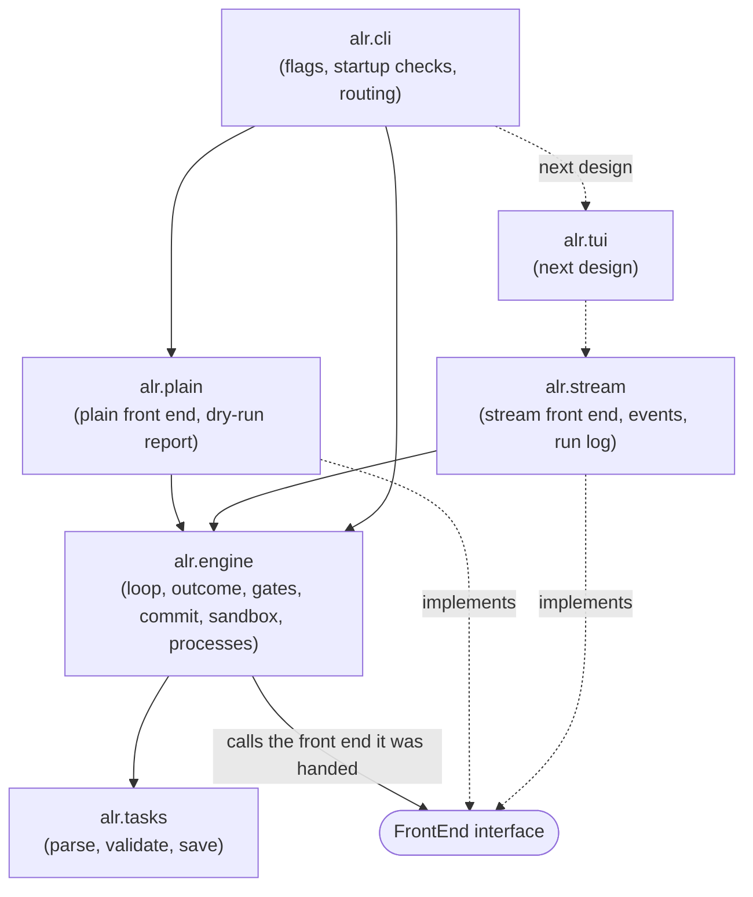
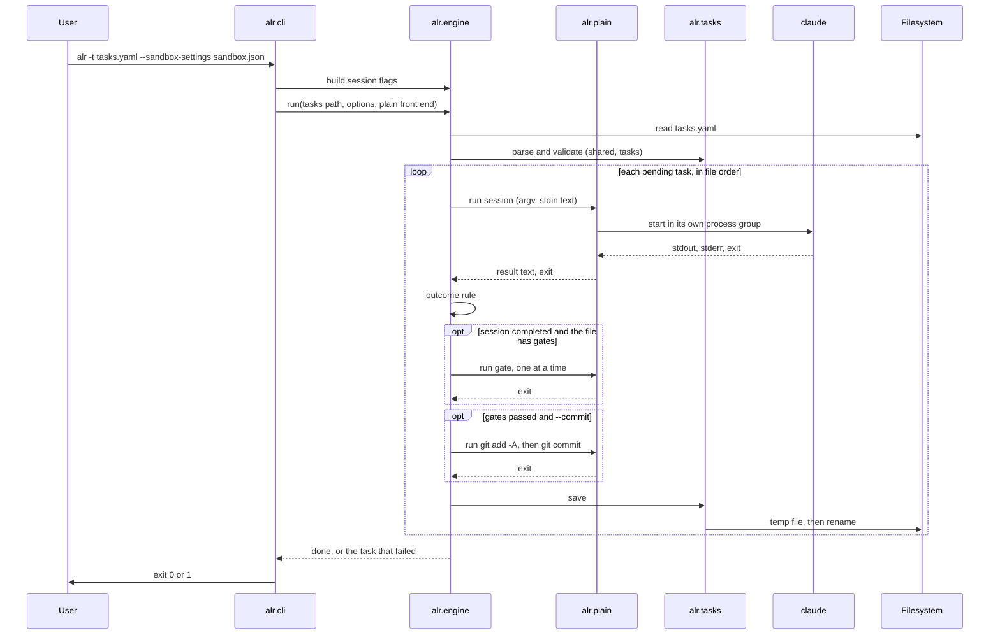
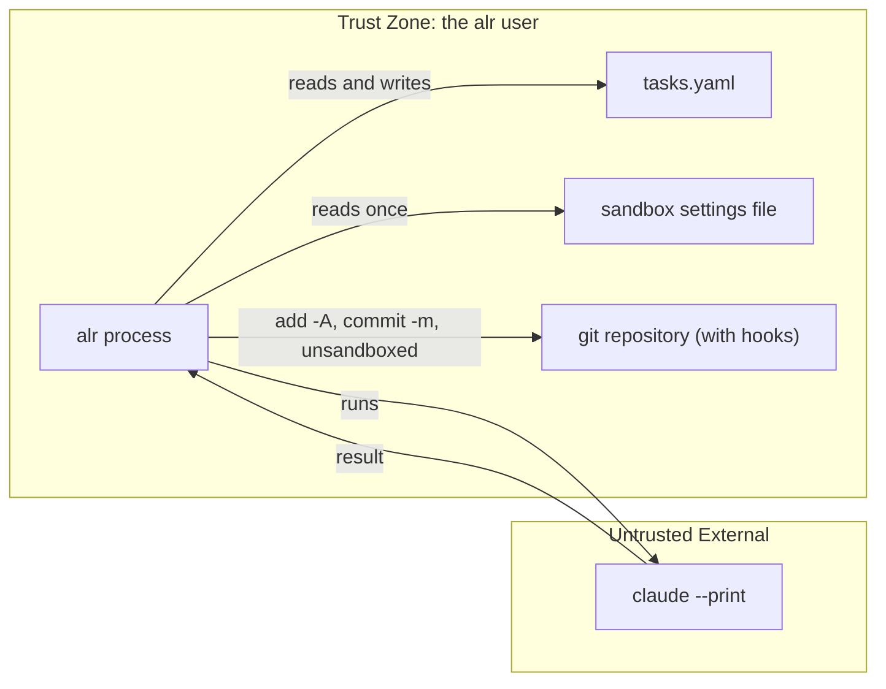

# alr — System Architecture

[Back to Overview](00_overview.md) | [Back to Project README](../../README.md)

## Table of Contents

- [Architecture Overview](#architecture-overview)
- [Package Layout](#package-layout)
- [Component Breakdown](#component-breakdown)
- [The Front End Interface](#the-front-end-interface)
- [Data Flow](#data-flow)
- [Error Handling](#error-handling)
- [Testing](#testing)
- [Component Interactions](#component-interactions)
- [Boundary Definitions](#boundary-definitions)

## Architecture Overview

`alr` has one engine and two front ends. The engine holds the rules of a run. A front end decides how each subprocess is run and shown. `alr.cli` picks the front end once and hands it to the engine; the engine never asks which one it got.

Imports point one way. `cli` imports everything below it. `plain` and `stream` import `engine`. `engine` imports `tasks`. Nothing imports upward, and `plain` and `stream` never import each other.



In this design `alr.cli` always picks the plain front end. The stream front end and the run log are complete and tested, and the next design switches them on from the TUI.

## Package Layout

```
src/alr/
  main.py          entry point: runs cli, sets the exit code
  cli.py           flags, startup checks in gralph's order, routing, the run folder lookup
  errors.py        AlrError and its subclasses
  durations.py     parse and format durations such as 90s and 1m30.5s
  tasks.py         task file: the shared block and tasks, parse, validate, atomic save, timeout parsing
  engine/
    frontend.py    the FrontEnd interface
    loop.py        load the task file, the run loop, save after each task
    result.py      last-line JSON result and the outcome rule
    gates.py       gate order, effective timeout, first failure fails the task
    commit.py      repository checks, add -A, the commit rule
    sandbox.py     the run folder's sandbox.json, session flags from sandbox settings or skip-permissions
    proc.py        process groups, kill on cancel, git's gentle stop
  plain/
    frontend.py    echo the prompt, tee Claude's stdout, pass output through,
                   print the gate and commit lines
    report.py      the task table, the failed-task notice, the no-repository notice
    start.py       a real run in plain mode: load, check, run
    dryrun.py      the dry-run report: gate limits, sandbox and commit notices
  stream/
    frontend.py    adds the stream-json flags, captures output, emits events
    parser.py      stream-json lines into activity lines and the result text
    events.py      the event types
    runlog.py      the --log-dir writer: run.jsonl and task-<id>.log
tests/
  unit/            one test file per module, with its own conftest, helpers, and fakeclaude/
  e2e/             black-box tests that run the installed alr command in a container, with
                   their own conftest, helpers, requirements, Dockerfile, and fake claude
  docker-compose.yaml  starts the e2e container
```

How gralph's packages map onto this:

| gralph                                         | alr                                              |
| ---------------------------------------------- | ------------------------------------------------ |
| `cmd/main`                                     | `alr.main`, `alr.cli`                            |
| `internal/tasks`                               | `alr.tasks`                                      |
| `internal/looper` (shared rules)               | `alr.engine`                                     |
| `internal/looper` (`report == nil` branches)   | `alr.plain`                                      |
| `internal/looper` (`report != nil` branches)   | `alr.stream.frontend`, `alr.stream.parser`       |
| `internal/looper/event.go`                     | `alr.stream.events`                              |
| `internal/runlog`                              | `alr.stream.runlog`                              |
| `internal/tui`, `internal/skillinstall`        | Next design                                      |

## Component Breakdown

### CLI (alr.cli, alr.main)

**Responsibilities:**

- Parse the flags listed in [Requirements](01_requirements.md#command-line) with `argparse`, prefix abbreviation off
- Run the startup checks in gralph's order: resolve `--dir` (the task file and the folder's `sandbox.json`), check `--gate-timeout`, pick the front end, check plain mode's required flags, check `--log-dir`, build the session flags
- Route to the dry run or the real run with the plain front end
- Install the SIGINT and SIGTERM handlers that cancel the run
- Catch `AlrError` in one place: print `error: <message>` to stderr and exit 1
- Exit 0 only when every task completed

**Key Characteristics:**

| Characteristic | Value                                             |
| -------------- | ------------------------------------------------- |
| Runtime        | Python 3.12+, `argparse`, `asyncio.run`           |
| State          | None; passes values down                          |
| Mode           | Always plain in this design                       |

### Task File (alr.tasks)

**Responsibilities:**

- Compose the file into YAML nodes with PyYAML's standard safe loader and reject any tag outside the core set, including `<<` merge keys, before reading values
- Validate the `shared` block (a required `prompt`, optional `gates`) and every task with gralph's field rules and errors shaped as (`tasks[<index>] (id <id>): <field>: <problem>`, `shared.prompt: <problem>`, `shared.gates[<j>]: <field>: <problem>`)
- Reject a top-level `gates` key, any other unknown top-level key, and any `shared` key other than `prompt` and `gates`; the `gates` message says where gates live now
- Keep the difference between an absent `shared.gates` key (not decided) and `shared.gates: []` (decided: none)
- Trim `shared.prompt` on load
- Normalize an empty `state` to `pending`; never alter `name` or `prompt`
- Produce the task text sent to Claude: `<id>: <name>`, a blank line, then the prompt, trimmed
- Parse durations (`90s`, `10m`, `1h30m`) for gate timeouts and `--gate-timeout`
- Save atomically: write a temp file, then rename over the original; 2-space indent, `shared` above `tasks`

**Key Characteristics:**

| Characteristic   | Value                                          |
| ---------------- | ---------------------------------------------- |
| Library          | PyYAML (`yaml.compose`), dataclasses           |
| Validation model | Strict: one invalid element rejects the file   |
| Comments         | Not preserved on save                          |
| Unknown task key | Ignored and dropped on save, except `gates`    |
| Unknown root key | An error, so a typo or a leftover cannot hide  |

### Engine (alr.engine)

**Responsibilities:**

- Load the task file; the shared prompt is `shared.prompt`, already trimmed and known to be non-empty
- Refuse to run when any task is `failed`
- Walk pending tasks in file order; skip `completed` tasks
- Build the stdin text: `shared.prompt`, a blank line, the task text, a newline
- Build the Claude argv: `claude --print`, then the front end's extra flags, then the session flags
- Ask the front end to run the session, then apply the outcome rule: `completed` only on a zero exit and a last non-blank, non-fence line that is JSON with `"state": "completed"`
- After a completed session, run the file's `shared.gates` in order, each as `sh -c <cmd>` with no stdin and a time limit (`--gate-timeout`, else the gate's `timeout`, else 10 minutes); stop at the first failure
- With `--commit`, after the gates pass: `git add -A`, then `git commit -m <task name>` when anything is staged
- Save the task file after every task; stop the run at the first failed task
- Measure the duration of each session, gate, task, and the run
- On cancellation, kill the running process group and change nothing; git gets SIGTERM, up to 2 seconds, then SIGKILL
- Find the run folder's settings file: `<folder>/sandbox.json` when it is a regular file, so `--dir` can supply `--sandbox-settings` (ADR-009)
- Build the session flags: for `--sandbox-settings`, merge the file with the three forced sandbox keys and return `--permission-mode acceptEdits --settings <merged JSON>`; for `--skip-permissions`, return `--dangerously-skip-permissions`
- Check the repository for `--commit`: clean work tree, task file ignored or outside the repository

**Key Characteristics:**

| Characteristic | Value                                                            |
| -------------- | ---------------------------------------------------------------- |
| Runtime        | `asyncio`; one task at a time                                    |
| Output         | None. The engine never writes to stdout or stderr                |
| Mode knowledge | None. It calls the front end it was handed                       |
| Imports        | `alr.tasks`, `alr.errors`, the standard library                  |

### Plain Front End (alr.plain)

**Responsibilities:**

- Run a session with no extra Claude flags: echo the combined prompt, copy Claude's stdout to the terminal while keeping it for the result line, and let stderr pass straight through
- Before each gate, print `gate: <cmd>`; let the gate's output pass straight through
- Once something is staged, print `commit: <first line of name>`; let git's output pass straight through
- Print the failed-task notice and task table when the file already holds a failed task
- Dry run: print the task table, each `shared.gates` entry with its effective limit and where the limit came from, the sandbox settings path (from a flag or the run folder), and the commit notice; never start Claude or write a file

**Key Characteristics:**

| Characteristic | Value                                             |
| -------------- | ------------------------------------------------- |
| Used when      | Every run in this design                          |
| Output         | Plain text on stdout and stderr, same as gralph   |
| Imports        | `alr.engine`, `alr.tasks`; never `alr.stream`     |

### Stream Front End (alr.stream)

**Responsibilities:**

- Run a session with `--output-format stream-json --verbose`; write nothing to the terminal
- Read stdout and stderr at the same time, line by line with no length limit
- Turn `assistant` events into activity lines (text lines, and `→ <Tool> <target>` for tool use) and keep the `result` event's text for the outcome
- Report gate and git output as activity lines, with `→ gate <cmd>` and `→ commit <name>` markers
- Emit events to a `report` callback: `TaskStarted`, `Activity`, `SessionFinished`, `GateFinished`, `Committed`, `TaskFinished`, `RunDone`; a cancelled session or gate emits none of the finished kinds
- Run log (`runlog.py`): create the run folder (`0700`, files `0600`), write `run_started`, append one ledger line per event to `run.jsonl` with gralph's key order, and append activity to `task-<id>.log`

**Key Characteristics:**

| Characteristic | Value                                                    |
| -------------- | -------------------------------------------------------- |
| Used when      | Tests only in this design; the TUI in the next           |
| Output         | Events and log files; nothing on stdout or stderr        |
| Imports        | `alr.engine`, `alr.tasks`; never `alr.plain`             |

## The Front End Interface

`alr.engine.frontend` defines the one interface both front ends implement. The engine owns when each call happens and what the result means. The front end owns how output is handled.

| Call                 | Engine asks the front end to                                             | Plain                                   | Stream                                  |
| -------------------- | ------------------------------------------------------------------------ | --------------------------------------- | --------------------------------------- |
| extra session flags  | Give the Claude flags that follow `--print`                              | None                                    | `--output-format stream-json --verbose` |
| run session          | Run Claude with this argv and stdin; return the result text and the exit | Echo, tee stdout, pass stderr           | Capture, parse, emit `Activity`         |
| run gate             | Run this gate command under this limit; return the exit                  | Print `gate: <cmd>`, pass output        | Emit marker and output as `Activity`    |
| run git              | Run this git command; return the exit                                    | Pass output                             | Emit output as `Activity`               |
| task started         | Note that a task is starting                                             | Nothing                                 | Emit `TaskStarted`                      |
| session finished     | Note the session outcome and duration                                    | Nothing                                 | Emit `SessionFinished`                  |
| gate finished        | Note a gate's result and duration                                        | Nothing                                 | Emit `GateFinished`                     |
| commit started       | Note that something is staged and a commit follows                       | Print `commit: <name>`                  | Emit `→ commit <name>`                  |
| committed            | Note the new commit hash                                                 | Nothing                                 | Emit `Committed`                        |
| task finished        | Note the final state and duration                                        | Nothing                                 | Emit `TaskFinished`                     |
| run done             | Note the end of the run, with its error if any                           | Nothing                                 | Emit `RunDone`                          |

Both front ends start processes through `alr.engine.proc`, so process groups and the kill-on-cancel rule are the same for both.

## Data Flow

### A Real Run in Plain Mode



### Startup Order

1. Resolve `--dir`: fill an unset `--tasks` with `<folder>/tasks.yaml`, then fill an unset `--sandbox-settings` with `<folder>/sandbox.json` when that is a regular file and `--skip-permissions` was not passed. A folder with no `tasks.yaml` and no `--tasks` exits 1
2. Check `--gate-timeout` if passed
3. Pick the front end (always plain in this design)
4. Check plain mode's required flag, `--tasks`
5. Check `--log-dir`: on a real run, exit 1 with `--log-dir only works with the full-screen view`; ignored on `--dry-run`
6. Build the session flags: exactly one of `--sandbox-settings` (given, or found in the run folder) or `--skip-permissions` on a real run; a dry run needs neither but still checks a settings file it is given
7. Dry run or real run

### Stopping

SIGINT or SIGTERM cancels the run. The process group of whatever is running is killed. The interrupted task is not marked failed and the file is not written, so the task is still `pending` on the next run. `alr` exits 1.

## Error Handling

Two kinds of failure are kept apart.

**A task that fails is an outcome, not an exception.** A bad or missing result line, a non-zero exit from Claude, a failed or timed-out gate, or a commit git refuses makes the task `failed`, with the reason in its `error` field. The file is saved, the run stops, and `alr` exits 1. Error text keeps gralph's shape (for example `gate "<cmd>" failed: exit status 1`, `gate "<cmd>" timed out after <timeout>`, `commit failed: exit status 1`) without having to match it word for word (ADR-007).

**A problem with the run itself is an exception** under `AlrError` in `alr.errors`:

| Error                 | Raised when                                                              |
| --------------------- | ------------------------------------------------------------------------ |
| `UsageError`          | A flag is missing, conflicts with another, or has a bad value            |
| `TaskFileError`       | The task file cannot be read, parsed, validated (including `shared.prompt`), or saved |
| `FailedTasksError`    | The task file already holds a failed task                                |
| `SandboxError`        | The sandbox settings file is missing, unreadable, or not a JSON object   |
| `RepoError`           | `--commit` finds a dirty work tree, a tracked task file, or a broken git |
| `RunLogError`         | The run log cannot be opened or written                                  |
| `RunError`            | A task failed (after its state was saved), or its state cannot be saved  |
| `RunCancelledError`   | The run was stopped by a signal; a kind of `RunError`                    |

A failed task is saved as an outcome first. The engine then raises `RunError` so the run stops and the command exits 1 with `error: loop error: task <id>: <name> failed: <reason>`, as gralph does.

`alr.cli` catches `AlrError` once, prints `error: <message>`, and exits 1. Any other exception is a bug and is left to show its traceback. Lower-level errors are wrapped with `raise ... from ...` so the cause is kept.

## Testing

Tests are ported from gralph before the code they cover is written. There are two suites that share nothing (ADR-010).

| Layer            | Covers                                                                                                                                              | Ported from                                                       |
| ---------------- | --------------------------------------------------------------------------------------------------------------------------------------------------- | ----------------------------------------------------------------- |
| Unit             | Task validation tables, the result rule, stream-json parsing, the sandbox merge, gate limits, commit rules against real git, run log output         | `task_test.go`, `internal/looper/*_test.go`, `runlog_test.go`     |
| Fake `claude`    | A Python script placed first on `PATH`, driven by the same `FAKECLAUDE_*` variables: records argv and stdin, sets output and exit code, can block; one copy per suite | `testdata/fakeclaude/main.go`                         |
| End to end       | Runs the installed `alr` command as a subprocess, in a container: the loop, results, gates, commit, `--dir`, dry-run, `--no-tui`, `--log-dir`, sandbox, SIGINT, SIGTERM  | `tests/e2e/*_test.go`, except wizard, install-skill, skill-check  |
| Golden           | The exact stdin text sent to Claude                                                                                                                 | gralph's golden assertions                                        |
| Import boundary  | `engine` imports neither front end; the front ends do not import each other                                                                         | New                                                               |

`make test` runs ruff format and lint, then the unit tests (`pytest tests/unit`). The Docker build runs the unit tests only. The e2e suite runs in a container against the wheel in `dist/`: `make e2e` runs it against the wheel already built, and `make build` builds the wheel first. The e2e suite finds `alr` on `PATH` and never imports from `src/`. No real Claude and no network are needed.

## Component Interactions

| From            | To              | Protocol                              | Purpose                                   | Data Format                                 |
| --------------- | --------------- | ------------------------------------- | ----------------------------------------- | ------------------------------------------- |
| `cli`           | `engine`        | Function call (awaited)               | Session flags, repository checks, the run | Python values                               |
| `cli`           | `plain`         | Function call                         | Build the plain front end; the dry run    | Python values                               |
| `engine`        | front end       | The `FrontEnd` interface (awaited)    | Run subprocesses, report progress         | Python values                               |
| `engine`        | `tasks`         | Function call                         | Parse and save the task file              | YAML text, dataclasses                      |
| front end       | `engine.proc`   | Function call (awaited)               | Start a process group, kill it on cancel  | argv, Unix signals                          |
| front end       | `claude`        | Subprocess, stdin, stdout, stderr     | Run a session                             | Text; stream-json on the stream path        |
| front end       | gate command    | Subprocess (`sh -c`), exit code       | Check a completed task                    | Shell command text                          |
| front end       | git             | Subprocess, exit code                 | Commit a completed task                   | `git add -A`, `git commit -m <name>`        |
| `stream`        | `report`        | Callback                              | Hand each event to a listener             | `alr.stream.events` values                  |
| `stream.runlog` | Filesystem      | File appends                          | Write the ledger and detail files         | JSON lines; text                            |

## Boundary Definitions

The trust and process boundaries are gralph's, unchanged.



**Boundary Rules:**

| Boundary                    | What Crosses                    | Rules                                                                                                                             |
| --------------------------- | ------------------------------- | --------------------------------------------------------------------------------------------------------------------------------- |
| alr reads the filesystem    | Task file                       | Treated as code the user chose to run (its prompts go to Claude, its `shared.gates` to `sh -c`); not sanitized                    |
| alr reads the filesystem    | Sandbox settings file           | Read once, never written; must be a JSON object; three sandbox keys forced, the rest passed through. May come from the `--dir` folder's `sandbox.json`, which is as trusted as that folder's `tasks.yaml`                               |
| alr writes the filesystem   | Task state                      | Atomic: temp file, then rename                                                                                                    |
| alr writes the filesystem   | Run log                         | Only with `--log-dir`, only on the stream path; a new folder per run                                                              |
| alr starts Claude           | Combined prompt on stdin        | Fixed argv: `--print`, the front end's flags, the session flags                                                                   |
| alr starts a gate           | `cmd` text from the task file   | `sh -c <cmd>` in alr's working directory, unsandboxed, no stdin; only the exit code is used                                       |
| alr starts git              | `add -A`, `commit -m <name>`    | From the work tree root, unsandboxed, hooks run; never push, reset, stash, or `--no-verify`                                       |
| Claude returns to alr       | Stdout, stderr, exit code       | Only the last result line and the exit code decide the outcome                                                                    |
| alr and its child processes | Signals                         | Each child runs in its own process group; on cancel the group is killed; git gets SIGTERM, up to 2 seconds, then SIGKILL          |
