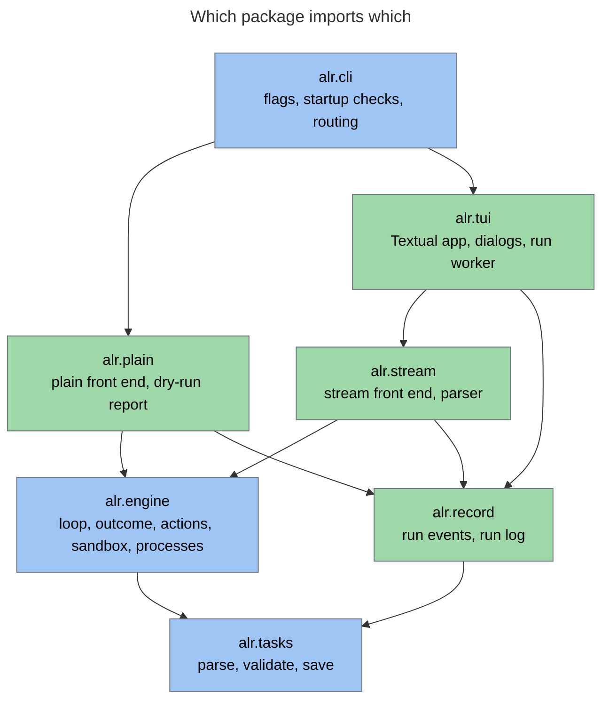
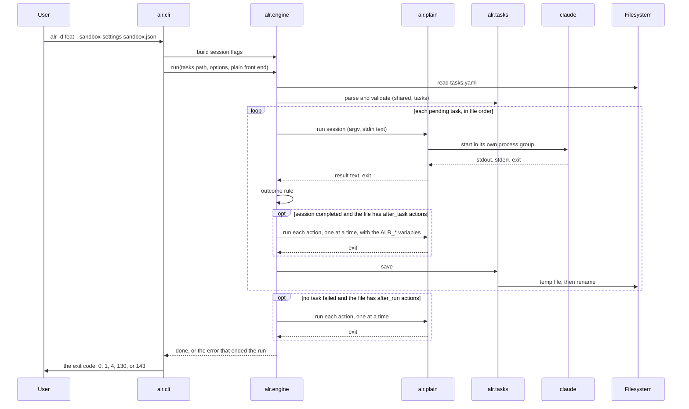
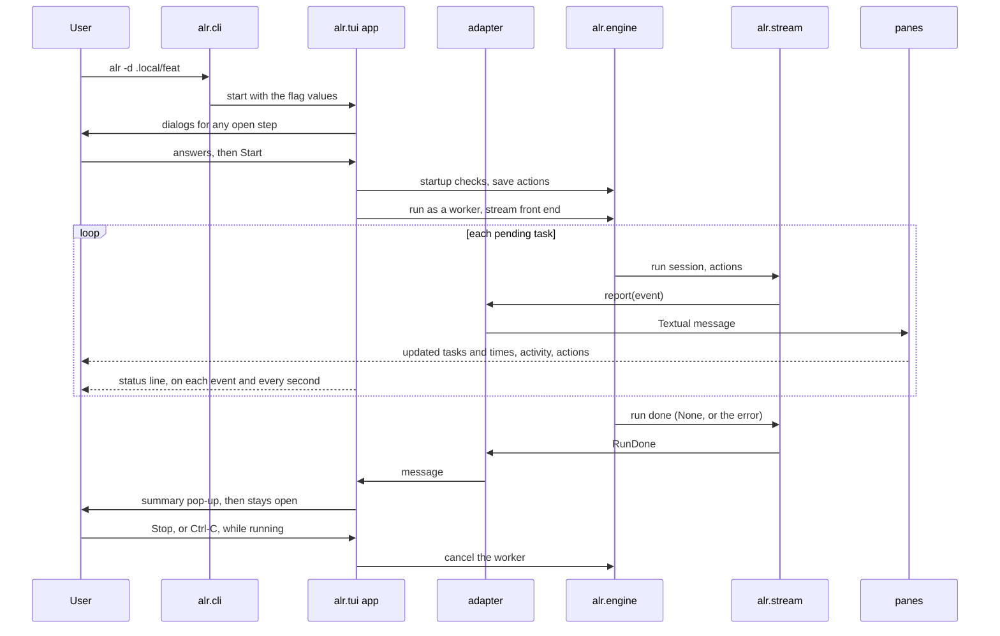
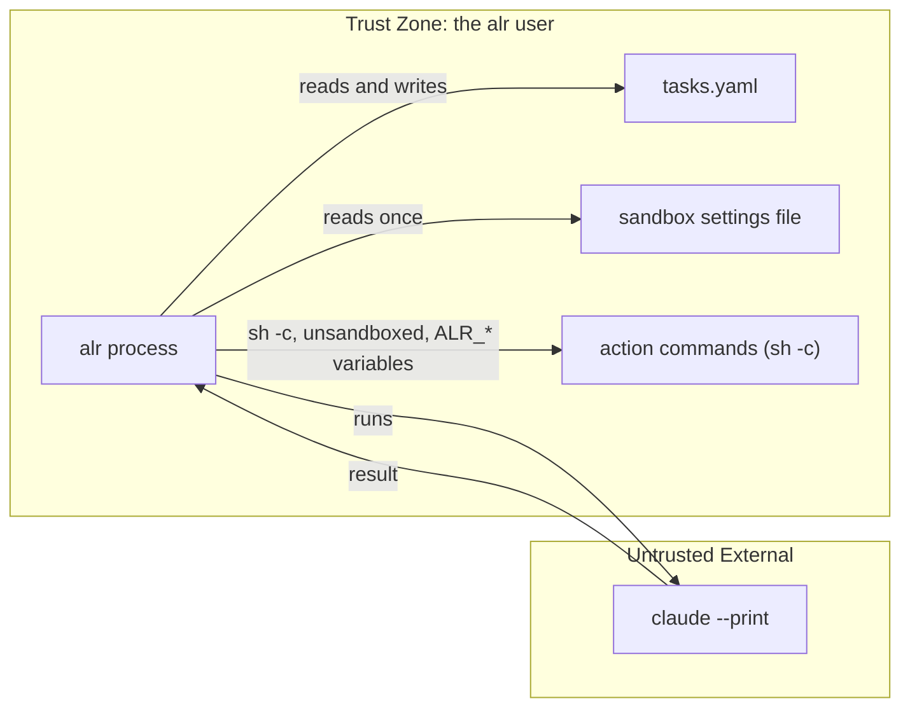

# alr — System Architecture

[Back to Overview](00_overview.md) | [Back to Project README](../../README.md)

## Table of Contents

- [Architecture Overview](#architecture-overview)
- [Package Layout](#package-layout)
- [Component Breakdown](#component-breakdown)
- [The Front End Interface](#the-front-end-interface)
- [Data Flow](#data-flow)
- [Error Handling](#error-handling)
- [Testing](#testing)
- [Component Interactions](#component-interactions)
- [Boundary Definitions](#boundary-definitions)

## Architecture Overview

`alr` has one engine and two front ends. The engine holds the rules of a run. A front end decides how each subprocess is
run and shown. `alr.cli` picks the front end once and hands it to the engine; the engine never asks which one it got.
The plain front end serves scripts and CI. The stream front end serves the full-screen view, `alr.tui`, which owns the
terminal.

Imports point one way. `cli` imports everything below it (the first diagram leaves out its direct edges to `engine` and
`tasks`). `plain` and `stream` import `engine` and `record`. `tui` imports `stream`, `record`, `engine`, and `tasks`.
`engine` imports `tasks`. `record` imports only `tasks`, `errors`, and the standard library, and `engine` never imports
it. Nothing imports upward, `plain` and `stream` never import each other, and `tui` never imports `plain`.



The engine does not import a front end. It is handed one and calls it through the `FrontEnd` interface, which `alr.cli`
picks once:


`alr.cli` picks the stream front end, inside `alr.tui`, when stdin and stdout are terminals, `--plain` is absent, and
the run is not a `--dry-run` (ADR-013). Every other run uses the plain front end.

## Package Layout

```text
src/alr/
  main.py          entry point: runs cli, sets the exit code
  cli.py           flags, startup checks in gralph's order, routing, the run folder lookup
  errors.py        AlrError and its subclasses, each with its exit code, and the refusal reasons
  durations.py     parse and format durations such as 90s and 1m30.5s
  skillinstall.py  --install-skill: copy the bundled skill to ~/.claude/skills (ADR-016)
  skills/          the bundled gralph-docs-writer skill, as package data
  tasks.py         task file: the shared block and tasks, parse, validate (a task name is one line), atomic save, timeout parsing, `RunResult` and `PASSED`
  engine/
    frontend.py    the FrontEnd interface
    loop.py        load the task file, the run loop, save after each task (or once, in run mode), the result and exit code of a run
    stop.py        which signal stopped the run, and the exit code it gives
    result.py      last-line JSON result and the outcome rule
    actions.py     run an action list in order, the ALR_* variables, effective timeout, first failure
    sandbox.py     the run folder's sandbox.json, session flags from sandbox settings or --yolo
    proc.py        process groups, kill on cancel
  plain/
    frontend.py    echo the prompt, tee Claude's stdout, pass output through,
                   print the action lines
    report.py      the task table, the failed-task notice
    start.py       a real run in plain mode: load, check, run
    dryrun.py      the dry-run report: action limits and the sandbox settings path
  record/
    events.py      the event types
    runlog.py      the run log writer: run.jsonl and task-<id>.log
  stream/
    frontend.py    adds the stream-json flags, captures output, emits events
    parser.py      stream-json lines into activity lines and the result text
  tui/
    app.py         the Textual app: states, Start and Stop, the run worker
    adapter.py     the report callback: events into Textual messages
    settings.py    the run settings the strip and the dialogs fill
    progress.py    follows the run events and gives the status line's text (ADR-020)
    screens/       the main screen, the folder, permissions, and actions dialogs, the file viewer,
                   the finished summary
    panes/         the tasks, activity, and actions panes
tests/
  unit/            one test file per module, with its own conftest, helpers, and fakeclaude/
  e2e/             black-box tests that run the installed alr command in a container, with
                   their own conftest, helpers, requirements, Dockerfile, and fake claude
  docker-compose.yaml  starts the e2e container
```

How gralph's packages map onto this:

| gralph                                       | alr                                        |
|----------------------------------------------|--------------------------------------------|
| `cmd/main`                                   | `alr.main`, `alr.cli`                      |
| `internal/tasks`                             | `alr.tasks`                                |
| `internal/looper` (shared rules)             | `alr.engine`                               |
| `internal/looper` (`report == nil` branches) | `alr.plain`                                |
| `internal/looper` (`report != nil` branches) | `alr.stream.frontend`, `alr.stream.parser` |
| `internal/looper/event.go`                   | `alr.record.events`                        |
| `internal/runlog`                            | `alr.record.runlog`                        |
| `internal/tui`                               | `alr.tui`                                  |
| `internal/skillinstall`, `skills/`           | `alr.skillinstall`, `alr/skills`           |

## Component Breakdown

### CLI (alr.cli, alr.main)

**Responsibilities:**

- Parse the flags listed in [Requirements](01_requirements.md#command-line) with `argparse`, prefix abbreviation off
- Run the startup checks in gralph's order: resolve `--dir` (the task file and the folder's `sandbox.json`), check
  `--action-timeout`, pick the front end, check plain mode's required flags, build the session flags
- Refuse the removed flags before any other step, with exit 2 and a message naming the replacement: `--commit` (a
  commit is an action now) and `--gate-timeout` (renamed `--action-timeout`) (ADR-026)
- Route to the dry run, the plain real run, or the full-screen view (ADR-013)
- Run `--install-skill` first, when passed: copy the bundled skill and exit 0 (ADR-016)
- Install the SIGINT and SIGTERM handlers that cancel the run
- Catch `AlrError` in one place: print `error: <message>` to stderr and exit with the error's own `exit_code` (ADR-025):
  `UsageError` 2, `RefusedError` 3, `AfterRunFailedError` 4, any other `AlrError` 1. argparse rejects a bad flag value
  itself, at parse time, with exit 2
- Record which signal arrived first in a `Stop` and exit 130 (SIGINT) or 143 (SIGTERM) when a signal stops the run; a
  second signal changes nothing
- Exit 0 only when every task completed

**Key Characteristics:**

| Characteristic | Value                                      |
|----------------|--------------------------------------------|
| Runtime        | Python 3.12+, `argparse`, `asyncio.run`    |
| State          | None; passes values down                   |
| Mode           | Full-screen on a terminal, plain otherwise |

### Task File (alr.tasks)

**Responsibilities:**

- Compose the file into YAML nodes with PyYAML's standard safe loader and reject any tag outside the core set, including
  `<<` merge keys, before reading values
- Validate the `shared` block (a required `prompt`, optional `after_task` and `after_run`) and every task with gralph's
  field rules and errors shaped as (`tasks[<index>] (id <id>): <field>: <problem>`, `shared.prompt: <problem>`,
  `shared.after_task[<j>]: <field>: <problem>`)
- Allow only `action` (required) and `timeout` (optional) in an action; any other key is an error
- Reject a top-level `gates` key, any other unknown top-level key, and any `shared` key other than `prompt`,
  `after_task`, and `after_run`. A `shared.gates` key and an action's `cmd` key get migration messages naming
  `shared.after_task` and `action` (ADR-026)
- Keep the difference between an absent `shared.after_task` key (not decided) and `shared.after_task: []` (decided:
  none). `after_run` has no undecided state: absent and `[]` both mean none
- Trim `shared.prompt` on load
- Normalize an empty `state` to `pending`; never alter `name` or `prompt`
- Produce the task text sent to Claude: `<id>: <name>`, a blank line, then the prompt, trimmed
- Parse durations (`90s`, `10m`, `1h30m`) for action timeouts and `--action-timeout`
- Save atomically: write a temp file, then rename over the original; 2-space indent, `shared` above `tasks`

**Key Characteristics:**

| Characteristic   | Value                                         |
|------------------|-----------------------------------------------|
| Library          | PyYAML (`yaml.compose`), dataclasses          |
| Validation model | Strict: one invalid element rejects the file  |
| Comments         | Not preserved on save                         |
| Unknown task key | Ignored and dropped on save, except `gates`   |
| Unknown root key | An error, so a typo or a leftover cannot hide |

### Engine (alr.engine)

**Responsibilities:**

- Load the task file; the shared prompt is `shared.prompt`, already trimmed and known to be non-empty
- Refuse to run when any task is `failed` (a refusal with the reason `failed-tasks`)
- Walk pending tasks in file order; skip `completed` tasks
- Build the stdin text: `shared.prompt`, a blank line, the task text, a newline
- Build the Claude argv: `claude --print`, then the front end's extra flags, then the session flags
- Ask the front end to run the session, then apply the outcome rule: `completed` only on a zero exit and a last
  non-blank, non-fence line that is JSON with `"state": "completed"`
- After a completed session, run the file's `shared.after_task` actions in order (ADR-026). Each is `sh -c <action>` in
  alr's working directory with no stdin and a time limit (`--action-timeout`, else the action's `timeout`, else 10
  minutes); stop at the first failure, which fails the task. alr does not undo an earlier action, so the order is the
  user's: a commit action goes last
- Set these environment variables on each action's process, on top of alr's own environment, so a value is data to the
  shell and never code: `ALR_TASK_FILE` and `ALR_LOG_DIR` (absolute paths) for every action, and `ALR_TASK_ID` and
  `ALR_TASK_NAME` for an `after_task` action
- A task is `completed` only when its session reported success and every `after_task` action exited 0; a failing or
  timed-out action saves the task `failed` with `action "<action>" failed: <exit text>` or `action "<action>" timed out
  after <limit>` as the error. Save the task file after every task and stop the run at the first failed task
- After the loop, run the file's `shared.after_run` actions once, the same way, with the task-less variables. This
  runs at the end of every run that has no failed task, including a run where every task was already completed, so a
  rerun after an `after_run` failure retries it. A failure raises `AfterRunFailedError` (exit 4); the tasks stay
  `completed`
- Know nothing about git. There is no commit mode, no repository check, and no lock: a commit is whatever the action
  does, and a task is not guaranteed its own commit
- Tell the front end how the run ended in `run_done`: a `result` (`completed`, `failed`, `run_failed`, or `stopped`)
  and the `exit_code` alr will return, taken from the error that ended the run or from the `Stop`
- Measure the duration of each session, action, task, and the run
- On cancellation, kill the running process group. The file is left untouched: the interrupted task stays `pending`
  (a stop during an `after_task` action included), and a stop during `after_run` leaves the tasks `completed`
- Find the run folder's settings file: `<folder>/sandbox.json` when it is a regular file, so `--dir` can supply
  `--sandbox-settings` (ADR-009)
- Build the session flags: for `--sandbox-settings`, merge the file with the three forced sandbox keys and return
  `--permission-mode acceptEdits --settings <merged JSON>`; for `--yolo`, return
  `--dangerously-skip-permissions`

**Known limits of actions:**

- alr ends only the process group it started. After a SIGKILL of alr, an action or a Claude session can keep running,
  and one still running can write into a later run's work tree.
- Nothing stops two runs in one work tree. alr takes no lock, so one run's commit action can commit the other's changes.
- A commit action takes whatever is in the work tree; keeping `tasks.yaml` and the logs out of it is the action's job.
  The template and the bundled skill use the long `:(exclude)` form with `ALR_TASK_FILE` and `ALR_LOG_DIR`, because git
  ignores the short `:!` form when the path is absolute.
- An earlier action's effects stay when a later one fails.

**Key Characteristics:**

| Characteristic | Value                                             |
|----------------|---------------------------------------------------|
| Runtime        | `asyncio`; one task at a time                     |
| Output         | None. The engine never writes to stdout or stderr |
| Mode knowledge | None. It calls the front end it was handed        |
| Imports        | `alr.tasks`, `alr.errors`, the standard library   |

### Plain Front End (alr.plain)

**Responsibilities:**

- Run a session with no extra Claude flags: echo the combined prompt, copy Claude's stdout to the terminal while keeping
  it for the result line; copy stderr to the terminal too. Each completed line of either stream is reported as
  `Activity` (ADR-023). The session's output is read to the end
- Before each action, print `action: <action>`; copy the action's stdout and stderr to the terminal as raw bytes and
  report each line as `Activity` (the action sees a pipe, not a terminal). Once the action has exited, its reads stop
  after 2 seconds, so a background process that still holds the pipe cannot hold the run up (ADR-023)
- Print the failed-task notice and task table when the file already holds a failed task
- Raise the refusals in a fixed order, so a refused run leaves nothing on disk: an unreadable or invalid task file
  (`invalid-task-file`), `--reset-failed` applied to the in-memory list, the failed-task check on
  that list, opening the run log (`log-unwritable`), and last saving the reset (`task-file-unwritable`, after which the
  log is closed and the run folder it made is removed, with the `logs/` folder too when the run created it and it is
  empty). A refusal never leaves a run folder: opening the log removes the folder it made when `run.jsonl` cannot be
  opened, and that cleanup also removes a `logs/` folder it made while empty. The dry run takes the same steps with the
  same `logs/` path it would use, minus the reset and opening the log. It checks that the log folder can be written
  (`log-unwritable`) without creating it, so it refuses as a real run does: a `failed` task prints the table and then
  exits 3 (`failed-tasks`) and an unwritable log folder exits 3 (`log-unwritable`). Only the plain start adds
  `failed to start loop runner:` to an invalid-file message
- Record the run (ADR-019): write the run log in `<dir>/logs/<timestamp>/` on every real run, with the ledger
  (`run.jsonl`) and a detail file per task (`task-<id>.log`) holding the lines of Claude's raw stdout plus the
  `→ action <action>` markers, the action's output, and Claude's stderr (ADR-023)
- Dry run: print the task table, an `after_task:` or `after_run:` line for each action with its effective limit and where
  the limit came from, and the sandbox settings path (from a flag or the run folder); never start Claude or write a
  file, and refuse as a real run would

**Key Characteristics:**

| Characteristic | Value                                                             |
|----------------|-------------------------------------------------------------------|
| Used when      | A run is not full-screen: no terminal, `--plain`, or `--dry-run`  |
| Output         | Plain text on stdout and stderr                                   |
| Imports        | `alr.engine`, `alr.record`, `alr.tasks`; never `alr.stream`       |

### Stream Front End (alr.stream)

**Responsibilities:**

- Run a session with `--output-format stream-json --verbose`; write nothing to the terminal
- Read stdout and stderr at the same time, line by line with no length limit
- Turn `assistant` events into activity lines (text lines, and `→ <Tool> <target>` for tool use) and keep the `result`
  event's text for the outcome
- Report action output as activity lines, with a `→ action <action>` marker; an action's reads stop 2 seconds after the
  process exits, as in plain mode, while a session's are read to the end (ADR-023)
- Emit events to a `report` callback: `TaskStarted`, `Activity`, `SessionFinished`, `ActionStarted`, `ActionFinished`,
  `TaskFinished`, `RunDone`; `ActionStarted` follows the `→ action` marker (ADR-020); a cancelled session or action
  emits none of the finished kinds. Output from `after_run` actions is reported under a stand-in task with id 0 and the
  name "after the run"; no real task has id 0
- Record the run through `alr.record` when the Logging setting is on: the writer creates the run folder (`0700`, files
  `0600`; when two runs start in the same second the later one gets a `-1` suffix, then `-2`, and so on, and the
  caller is not told the final folder name, a known limit), writes `run_started`, appends one ledger line per event to `run.jsonl` with gralph's key order (`ActionStarted` adds
  nothing), and appends
  activity, including the parsed `→ Tool` lines, to `task-<id>.log`

**Key Characteristics:**

| Characteristic | Value                                             |
|----------------|---------------------------------------------------|
| Used when      | The full-screen view, through `alr.tui`           |
| Output         | Events and log files; nothing on stdout or stderr |
| Imports        | `alr.engine`, `alr.record`, `alr.tasks`; never `alr.plain` |

### TUI (alr.tui)

**Responsibilities:**

- Show one main window: a settings strip (the `Logging:` dropdown, the permissions label, and the Start button), a menu
  row of buttons with their hotkeys in the names (no footer), and three panes: tasks and actions side by side
  on top, a one-row status line, the activity pane across the full width below, then a status bar
- While a run goes, show where it is on the status line, which ticks every second (ADR-020):
  `task 2 of 5 · action 1 of 3: uv run pytest · 12.3s · run 1m 4s`, joined by ` · `: `task n of N` (N counts only the
  tasks pending at Start), the step (`session`, or `action i of n: <first line of the action>`, where n is the number of
  `after_task` actions), the step's time, and `run <time>`. When the line is wider than the widget, the step text is cut
  with a trailing `…` so the timers always show. Between tasks the line is only `task n of N · run <time>`. An
  `after_run` step reads `after the run: <first line of the action>`, and on a rerun where every task was already
  completed the line is that step, its time, and `run <time>`, with no task part. `alr.tui.progress` builds the text
  from the run events; the line is empty before the first task starts (or the first `after_run` action) and after the
  run ends
- Give the Tasks pane a `Time` column: the running task's time counts up every second, a finished task keeps the time
  its `TaskFinished` carries, and a task that has not run this time stays blank
- Let the activity pane follow the running task: a task start moves the tasks highlight and shows only that task's
  lines, wrapped and redrawn on resize; the arrow keys can show another task's lines. The pane keeps only the last
  5,000 lines per task and drops older ones without saying so; the run log keeps every line
- Show elapsed times with `format_elapsed` (`1h 2m 3s`) in the summary pop-up, the status bar, the status line, the Time column, and the action times
- Lock the dropdowns at Start for good; while a run goes, make the Start button `Stop (^c)` and grey out Folder,
  Permissions, Reset, and Quit; at the end disable Start again and re-enable Quit (Folder, Permissions, and Reset stay off). The Actions button is not greyed out but does nothing
  while a run is going; the Tasks and Sandbox viewers open any time
- Keep the four states and what each allows: Setup (Start disabled, the reason shown), Ready, Running (settings locked,
  dialogs read-only), and Finished (a summary pop-up with the outcome and time, then the app stays open until quit)
- At launch open the folder, permissions, and actions dialogs in that order, each only when the flags and the task file
  leave it open; until Start, reopen any dialog from the menu
- Validate each answer with the functions a run uses, and keep the error in the dialog: `tasks.yaml` loads, the settings
  file loads
- Edit both action lists in one Actions dialog, "After each task" and "After the run", each action with an optional
  timeout; Add and Remove act on the list last focused, and Done with both empty is a decision that there are none
- Fill the same values the flags fill, then on Start run the usual startup checks, save the actions to `tasks.yaml` only
  if they pass, and start the engine as a worker (ADR-012)
- Turn each run event into a Textual message through the adapter, which holds only the function that posts messages, and
  let each pane update itself from those messages
- Bind Stop and Ctrl-C to cancelling the worker; show a run that ends with `RunDone` carrying `None` as done, a run the
  user stopped (the app's stop flag) as stopped, and any other error as failed; the error text of a cancelled run
  varies, so it is not matched
- Open a task file that holds failed tasks (`read_tasks`), show them with a cross, keep Start disabled with the reason
  "press r to reset", and reset them to pending (`reset_failed`) after a confirming pop-up (ADR-018)
- Open `tasks.yaml` and `sandbox.json` in a read-only viewer from the menu
- Capture no mouse and take every action from the keyboard: `s` starts a run, Ctrl-C stops it, `q` quits, and `f`, `p`, `a`, `t`, `x` open the Folder, Permissions, and Actions dialogs and the `tasks.yaml` and `sandbox.json` viewers; Esc cancels a dialog; the command palette is off (ADR-013)

**Key Characteristics:**

| Characteristic | Value                                                         |
|----------------|---------------------------------------------------------------|
| Library        | Textual                                                       |
| Runtime        | The app's own `asyncio` loop; the engine is one worker in it  |
| State          | The run settings, the app state, and the events seen so far   |
| Controls       | Keys only, no mouse, no footer, no command palette; Start becomes Stop (^c); no pause, skip, or retry |
| Imports        | `alr.stream`, `alr.record`, `alr.engine`, `alr.tasks`; never `alr.plain` |

## The Front End Interface

`alr.engine.frontend` defines the one interface both front ends implement. The engine owns when each call happens and
what the result means; the engine, not the front end, applies each action's time limit. The front end owns how output is handled.

| Call                | Engine asks the front end to                                             | Plain                                                                 | Stream                                                  |
|---------------------|--------------------------------------------------------------------------|-----------------------------------------------------------------------|---------------------------------------------------------|
| extra session flags | Give the Claude flags that follow `--print`                              | None                                                                  | `--output-format stream-json --verbose`                 |
| run session         | Run Claude with this argv and stdin; return the result text and the exit | Echo, tee stdout and stderr, emit `Activity`                          | Capture, parse, emit `Activity`                         |
| run action          | Run this action command with these `ALR_*` variables added; return the exit | Print `action: <action>`, tee output as `Activity`, and emit `ActionStarted` | Emit marker and output as `Activity`, and `ActionStarted` |
| task started        | Note that a task is starting                                             | Nothing                                                               | Emit `TaskStarted`                                      |
| session finished    | Note the session outcome and duration                                    | Nothing                                                               | Emit `SessionFinished`                                  |
| action finished     | Note an action's result, limit, and duration                             | Emit `ActionFinished` to the run log                                  | Emit `ActionFinished`                                   |
| task finished       | Note the final state and duration                                        | Nothing                                                               | Emit `TaskFinished`                                     |
| run done            | Note the end of the run, with its error, `result`, and `exit_code`       | Emit `RunDone` to the run log                                         | Emit `RunDone`                                          |

Both front ends start processes through `alr.engine.proc`, so process groups and the kill-on-cancel rule are the same
for both.

## Data Flow

### A Real Run in Plain Mode



### A Real Run in the Full-Screen View



### Startup Order

Before step 1, argparse checks the command line. A flag it does not know is rejected there and exits 2. `--commit` and
`--gate-timeout` are known only to be refused: the first step after parsing prints `error: --commit: removed; a commit is
an action now: put it in shared.after_task, see the HOWTO` or `error: --gate-timeout: renamed to --action-timeout` and
exits 2, ahead of every other check (ADR-026). The steps below raise `AlrError`s, each of which exits with its own code
(ADR-025): a `UsageError` exits 2 and a `RefusedError` exits 3.

1. With `--install-skill`: copy the bundled skill, print its path, and exit 0
2. Resolve `--dir`: the task file is `<folder>/tasks.yaml`, then fill an unset `--sandbox-settings` with
   `<folder>/sandbox.json` when that is a regular file and `--yolo` was not passed. A folder with no
   `tasks.yaml` is a usage error and exits 2
3. Check `--action-timeout` if passed
4. Pick the front end: full-screen when stdin and stdout are terminals, `--plain` is absent, and the run is not a
   `--dry-run`; otherwise plain
5. Check plain mode's required flag, `--dir`; a missing one exits 2. The full-screen view asks for a missing one in a dialog instead
6. Build the session flags: exactly one of `--sandbox-settings` (given, or found in the run folder) or
   `--yolo` on a real run, otherwise a usage error (exit 2); a dry run needs neither but still checks a settings file it
   is given, and an unreadable or invalid one is refused with the reason `invalid-sandbox-settings`
7. Dry run, plain real run, or the full-screen view. A task file that cannot be read or parsed is refused first, as
   `invalid-task-file`. alr does not look at git at any step. Every refusal prints
   `error: refused: <reason>: <message>` as its first stderr line and leaves nothing on disk: no run log, and the task
   file as it was. With `--reset-failed`, a real run sets failed tasks back to pending silently, in memory first (the view
   does that when it first reads the file, so Start is enabled), and saves the file only after every other check and the
   run log have passed; if that save fails (or, in the view, the save of edited actions does) the run is
   refused as `task-file-unwritable` and the run folder it made is removed, with
   the `logs/` folder too when the run created it and it is empty.
   The dry run refuses like a real run (exit 3, including `failed-tasks` and `log-unwritable`);
   `--reset-failed` with `--dry-run` is a usage error (exit 2, ADR-018). The view repeats steps 1 to 5 on Start with the dialogs' values

### Stopping

SIGINT or SIGTERM cancels the run. In the full-screen view, Stop and Ctrl-C do the same through the worker, and the run
ends with a `RunDone` error that the app shows as stopped, since it set its stop flag. The process group of whatever is
running is killed. The interrupted task is not marked failed and the file is not written, so the task is still `pending`
on the next run, even when the stop came during one of its `after_task` actions. A stop during an `after_run` action
leaves the tasks `completed`, since they were saved before it started. The run log's `run_finished` has the result
`stopped`. `alr` exits 130 after SIGINT and 143 after SIGTERM; the first signal decides, and a later one changes
nothing (ADR-025). The full-screen view exits
with the same codes from the same table. The app owns one `Stop`: its SIGTERM handler sets the signal to SIGTERM before
it stops the run, the worker passes the same object to the engine, and the exit code is read from it, so SIGTERM exits
143 with or without a run going, and Stop or Ctrl-C keeps 130. A second Stop press while the engine is still stopping
sets the exit code from the `Stop` before it closes the app, so a stopped run never exits 0.

### Exit Codes

| Code | Outcome                 | Run log `result`  | Reason                                                              |
|------|-------------------------|-------------------|---------------------------------------------------------------------|
| 0    | Completed               | `completed`       | None                                                                |
| 1    | A task or action failed | `failed`          | The `after_task` action's or session's own text, in `error`         |
| 2    | Usage error             | No log            | argparse's message, or the `UsageError` text                        |
| 3    | Refused to start        | No log            | First stderr line `error: refused: <reason>: <message>`             |
| 4    | An `after_run` action failed | `run_failed` | `action "<action>" failed: <exit text>` or `action "<action>" timed out after <limit>`; every task stays `completed` |
| 130  | Stopped by SIGINT       | `stopped`         | None                                                                |
| 143  | Stopped by SIGTERM      | `stopped`         | None                                                                |

Each `AlrError` class carries its `exit_code`, and `alr.cli` maps it, so there is no scattered `return 1`. The engine
reports the same `result` and code through `run_done`, and the run log writes them as `run_finished.result` and
`run_finished.exit`. Every action writes an `action_finished` line with its result and the limit it ran under;
`run_started` records `action_timeout` when `--action-timeout` was passed. Exit 4 used to mean a failed commit (ADR-025,
amended by ADR-026).

## Error Handling

Two kinds of failure are kept apart.

**A task that fails is an outcome, not an exception.** A bad or missing result line, a non-zero exit from Claude, or a
failed or timed-out `after_task` action makes the task `failed`, with the reason in its `error` field. The file is
saved, the run stops, and `alr` exits 1. Error text keeps gralph's shape (for example
`action "<action>" failed: exit status 1` and `action "<action>" timed out after <timeout>`) without having to match it
word for word (ADR-007).

**A problem with the run itself is an exception** under `AlrError` in `alr.errors`:

| Error               | Exit       | Raised when                                                                                  |
|---------------------|------------|----------------------------------------------------------------------------------------------|
| `UsageError`        | 2          | A flag is missing, conflicts with another, or has a bad value (argparse's own rejections exit 2) |
| `RefusedError`      | 3          | alr declines to start; carries a reason word (`failed-tasks`, `invalid-task-file`, `invalid-sandbox-settings`, `log-unwritable`, `task-file-unwritable`) |
| `FailedTasksError`  | 3          | The task file already holds a failed task; a kind of `RefusedError`                          |
| `TaskFileError`     | 1          | The task file cannot be read, parsed, validated (including `shared.prompt` and task names without line breaks or other control characters), or saved; at startup it is refused as `invalid-task-file`, or as `task-file-unwritable` when a save at startup fails (the `--reset-failed` reset, or the edited actions in the view) |
| `RunLogError`       | 1          | The run log cannot be written mid-run; when it cannot be opened at startup it is refused as `log-unwritable` |
| `RunError`          | 1          | A task failed (after its state was saved), or its state cannot be saved                      |
| `AfterRunFailedError` | 4        | An `after_run` action failed or timed out; the tasks stay `completed`; a kind of `RunError`  |
| `RunCancelledError` | 130 or 143 | The run was stopped by a signal; a kind of `RunError`, mapped through the `Stop`             |

A failed task is saved as an outcome first. The engine then raises `RunError` so the run stops and the command exits 1
with `error: loop error: task <id>: <name> failed: <reason>`, as gralph does. A failed `after_run` action has no task to
fail: the engine raises `AfterRunFailedError` (exit 4) after every task is saved.

In the full-screen view the same errors are shown, not printed. A problem in a dialog stays in the dialog. A problem
found on Start (a task file that cannot be read, a log folder that cannot be written) opens an error
pop-up and the app stays Ready. A failed or stopped run arrives as `RunDone` and shows in the Finished summary with the
engine's error text. An unexpected exception in the worker shows as a failed run, and Textual restores the terminal.

`alr.cli` catches `AlrError` once, prints `error: <message>`, and exits with the error's `exit_code` (see
[Exit Codes](#exit-codes)). A flag argparse rejects at parse time (an unknown flag, say) is not an `AlrError`: argparse
prints its own usage error and exits 2, before any startup step. Any other exception is a bug and is left to
show its traceback. Lower-level errors are wrapped with `raise ... from ...` so the cause is kept.

## Testing

Tests are ported from gralph before the code they cover is written. There are two suites that share nothing (ADR-010).

| Layer           | Covers                                                                                                                                                                                    | Ported from                                                      |
|-----------------|-------------------------------------------------------------------------------------------------------------------------------------------------------------------------------------------|------------------------------------------------------------------|
| Unit            | Task validation tables, the result rule, stream-json parsing, the sandbox merge, action limits and variables, run log output                                               | `task_test.go`, `internal/looper/*_test.go`, `runlog_test.go`    |
| Fake `claude`   | A Python script placed first on `PATH`, driven by the same `FAKECLAUDE_*` variables: records argv and stdin, sets output and exit code, can block; one copy per suite                     | `testdata/fakeclaude/main.go`                                    |
| End to end      | Runs the installed `alr` command as a subprocess, in a container: the loop, results, actions (with real `git commit` actions), `--dir`, dry-run, `--plain`, the run log, sandbox, SIGINT, SIGTERM                   | `tests/e2e/*_test.go`, except wizard, install-skill, skill-check |
| Golden          | The exact stdin text sent to Claude                                                                                                                                                       | gralph's golden assertions                                       |
| TUI unit        | Each pane and dialog under Textual's headless `run_test` and `Pilot`, fed by a fake event stream, one case per branch (ADR-011); the state rules, Start and Stop, and the dialogs' checks | New                                                              |
| TUI end to end  | Two pseudo-terminal runs in the container: a happy-path run and a Stop                                                                                                                    | gralph's `wizard_pty` and `wizard_signal` tests                  |
| Import boundary | `engine` imports neither front end; `plain`, `stream`, and `tui` do not import `plain`                                                                                                    | New                                                              |

`make test` runs ruff format and lint, then the unit tests in parallel with `pytest-xdist` (`-n auto`). The Docker build
runs the unit tests the same way, and only those. To run them one at a time, which is the way to use a debugger, use
`uv run pytest -n 0 tests/unit` (or one test file or `-k`). A `tasks.yaml` action may use `uv run pytest -n auto tests/unit`. The e2e suite runs in a container against the wheel in `dist/`: `make e2e` runs it against the wheel already
built, and `make build` builds the wheel first. The e2e suite finds `alr` on `PATH` and never imports from `src/`. No
real Claude and no network are needed.

## Component Interactions

| From            | To            | Protocol                           | Purpose                                   | Data Format                          |
|-----------------|---------------|------------------------------------|-------------------------------------------|--------------------------------------|
| `cli`           | `engine`      | Function call (awaited)            | Session flags, the run                    | Python values                        |
| `cli`           | `plain`       | Function call                      | Build the plain front end; the dry run    | Python values                        |
| `engine`        | front end     | The `FrontEnd` interface (awaited) | Run subprocesses, report progress         | Python values                        |
| `engine`        | `tasks`       | Function call                      | Parse and save the task file              | YAML text, dataclasses               |
| front end       | `engine.proc` | Function call (awaited)            | Start a process group, kill it on cancel  | argv, Unix signals                   |
| front end       | `claude`      | Subprocess, stdin, stdout, stderr  | Run a session                             | Text; stream-json on the stream path |
| front end       | action        | Subprocess (`sh -c`), exit code    | Check, commit, or finish a run            | Shell command text, `ALR_*` variables |
| `stream`        | `report`      | Callback                           | Hand each event to a listener             | `alr.record.events` values           |
| `cli`           | `tui`         | Function call                      | Open the full-screen view with the flags  | Python values                        |
| `tui` adapter   | panes         | Textual messages                   | Update the panes from run events          | One message type per event           |
| `tui` app       | `engine`      | Worker (awaited), cancel           | Start a run, stop it                      | Run options, the stream front end    |
| `record.runlog` | Filesystem    | File appends                       | Write the ledger and detail files         | JSON lines; text                     |

## Boundary Definitions

The trust and process boundaries are gralph's, unchanged.



**Boundary Rules:**

| Boundary                    | What Crosses                  | Rules                                                                                                                                                                                                     |
|-----------------------------|-------------------------------|-----------------------------------------------------------------------------------------------------------------------------------------------------------------------------------------------------------|
| alr reads the filesystem    | Task file                     | Treated as code the user chose to run (its prompts go to Claude, its `shared.after_task` and `shared.after_run` actions to `sh -c`); not sanitized                                                                                            |
| alr reads the filesystem    | Sandbox settings file         | Read once, never written; must be a JSON object; three sandbox keys forced, the rest passed through. May come from the `--dir` folder's `sandbox.json`, which is as trusted as that folder's `tasks.yaml` |
| alr writes the filesystem   | Task state                    | Atomic: temp file, then rename                                                                                                                                                                            |
| alr writes the filesystem   | Run log                       | Both modes write `<dir>/logs/<timestamp>/`, a new folder per run: plain mode always, the TUI through its Logging setting; never on a dry run.                                                               |
| alr writes the filesystem   | Action edits from the TUI     | Only on Start, after the startup checks pass; saved atomically with the task file                                                                                                                         |
| alr writes the filesystem   | Installed skill               | Only with `--install-skill`: the bundled folder is copied over `~/.claude/skills/gralph-docs-writer/`                                                                                                     |
| alr starts Claude           | Combined prompt on stdin      | Fixed argv: `--print`, the front end's flags, the session flags                                                                                                                                           |
| alr starts an action        | `action` text from the task file | `sh -c <action>` in alr's working directory, unsandboxed, no stdin, with `ALR_TASK_FILE` and `ALR_LOG_DIR` (and, for `after_task`, `ALR_TASK_ID` and `ALR_TASK_NAME`) set; only the exit code is used. What it does, git included, is the action's own business; alr never pushes, resets, or stashes on its own |
| Claude returns to alr       | Stdout, stderr, exit code     | Only the last result line and the exit code decide the outcome                                                                                                                                            |
| alr and its child processes | Signals                       | Each child runs in its own process group; on cancel the group is killed                                                                                  |
