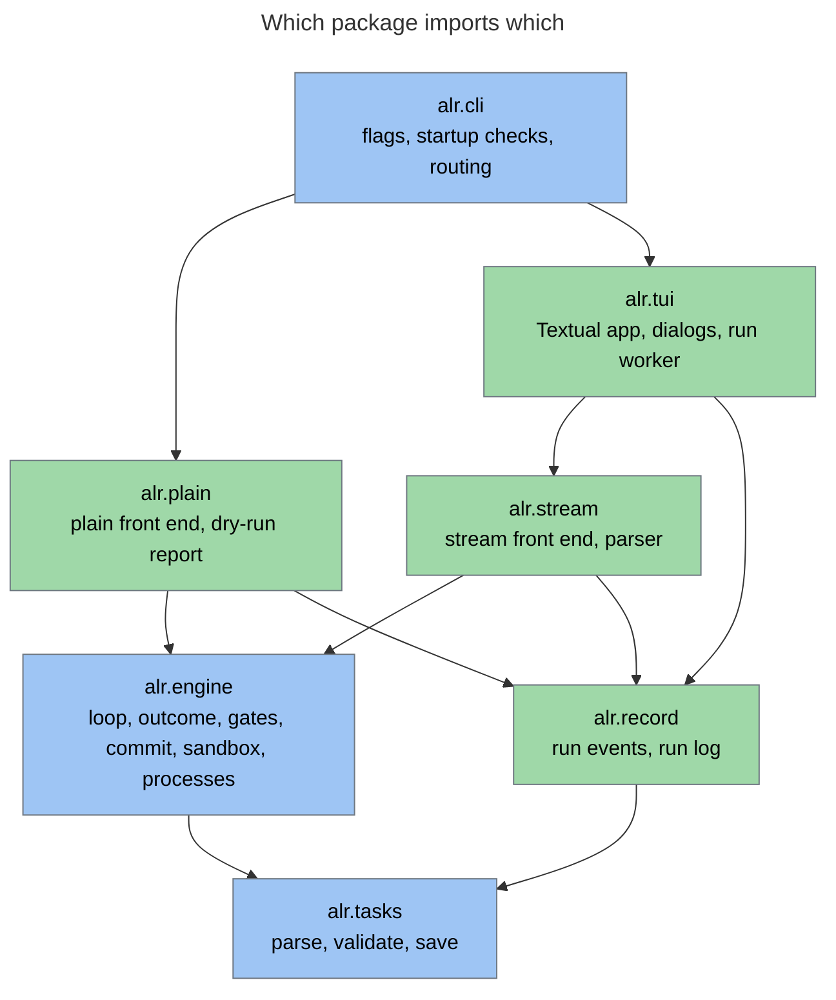
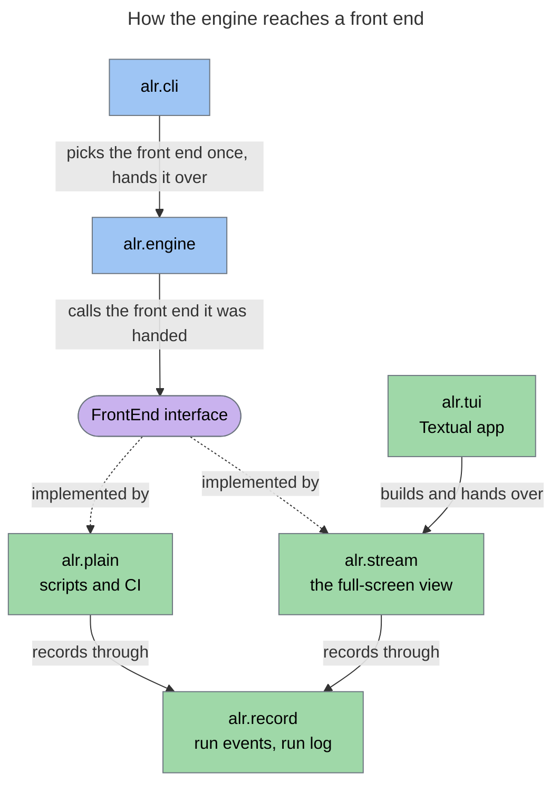
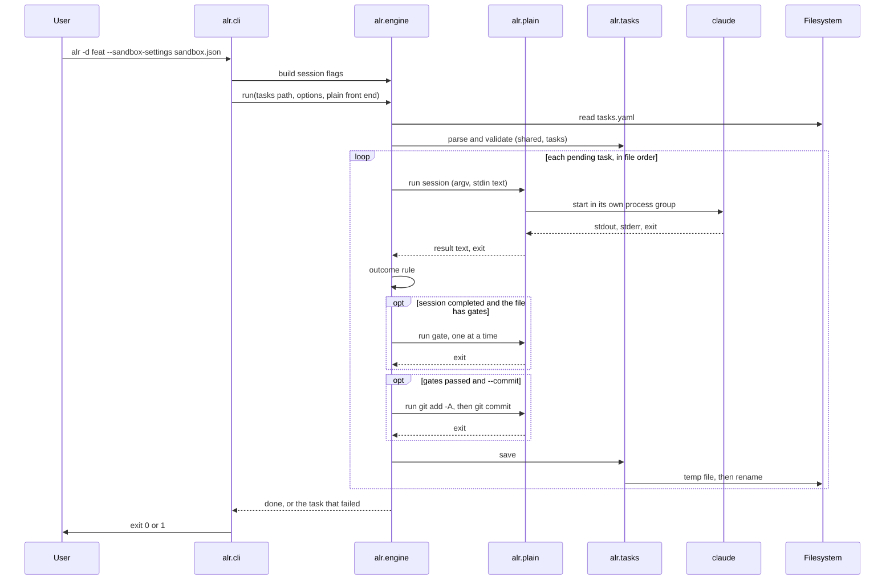

# alr — System Architecture

[Back to Overview](00_overview.md) | [Back to Project README](../../README.md)

## Table of Contents

- [Architecture Overview](#architecture-overview)
- [Package Layout](#package-layout)
- [Component Breakdown](#component-breakdown)
- [The Front End Interface](#the-front-end-interface)
- [Data Flow](#data-flow)
- [Error Handling](#error-handling)
- [Testing](#testing)
- [Component Interactions](#component-interactions)
- [Boundary Definitions](#boundary-definitions)

## Architecture Overview

`alr` has one engine and two front ends. The engine holds the rules of a run. A front end decides how each subprocess is
run and shown. `alr.cli` picks the front end once and hands it to the engine; the engine never asks which one it got.
The plain front end serves scripts and CI. The stream front end serves the full-screen view, `alr.tui`, which owns the
terminal.

Imports point one way. `cli` imports everything below it (the first diagram leaves out its direct edges to `engine` and
`tasks`). `plain` and `stream` import `engine` and `record`. `tui` imports `stream`, `record`, `engine`, and `tasks`.
`engine` imports `tasks`. `record` imports only `tasks`, `errors`, and the standard library, and `engine` never imports
it. Nothing imports upward, `plain` and `stream` never import each other, and `tui` never imports `plain`.



The engine does not import a front end. It is handed one and calls it through the `FrontEnd` interface, which `alr.cli`
picks once:



`alr.cli` picks the stream front end, inside `alr.tui`, when stdin and stdout are terminals, `--plain` is absent, and
the run is not a `--dry-run` (ADR-013). Every other run uses the plain front end.

## Package Layout

```
src/alr/
  main.py          entry point: runs cli, sets the exit code
  cli.py           flags, startup checks in gralph's order, routing, the run folder lookup
  errors.py        AlrError and its subclasses
  durations.py     parse and format durations such as 90s and 1m30.5s
  skillinstall.py  --install-skill: copy the bundled skill to ~/.claude/skills (ADR-016)
  skills/          the bundled gralph-docs-writer skill, as package data
  tasks.py         task file: the shared block and tasks, parse, validate, atomic save, timeout parsing
  engine/
    frontend.py    the FrontEnd interface
    loop.py        load the task file, the run loop, save after each task
    result.py      last-line JSON result and the outcome rule
    gates.py       gate order, effective timeout, first failure fails the task
    commit.py      repository checks, add -A, the commit rule, the per-task and after-all modes
    sandbox.py     the run folder's sandbox.json, session flags from sandbox settings or --yolo
    proc.py        process groups, kill on cancel, git's gentle stop
  plain/
    frontend.py    echo the prompt, tee Claude's stdout, pass output through,
                   print the gate and commit lines
    report.py      the task table, the failed-task notice, the no-repository notice
    start.py       a real run in plain mode: load, check, run
    dryrun.py      the dry-run report: gate limits, sandbox and commit notices
  record/
    events.py      the event types
    runlog.py      the run log writer: run.jsonl and task-<id>.log
  stream/
    frontend.py    adds the stream-json flags, captures output, emits events
    parser.py      stream-json lines into activity lines and the result text
  tui/
    app.py         the Textual app: states, Start and Stop, the run worker
    adapter.py     the report callback: events into Textual messages
    settings.py    the run settings the strip and the dialogs fill
    progress.py    follows the run events and gives the status line's text (ADR-020)
    screens/       the main screen, the folder, permissions, and gates dialogs, the file viewer,
                   the finished summary
    panes/         the tasks, activity, and gates-and-commits panes
tests/
  unit/            one test file per module, with its own conftest, helpers, and fakeclaude/
  e2e/             black-box tests that run the installed alr command in a container, with
                   their own conftest, helpers, requirements, Dockerfile, and fake claude
  docker-compose.yaml  starts the e2e container
```

How gralph's packages map onto this:

| gralph                                       | alr                                        |
|----------------------------------------------|--------------------------------------------|
| `cmd/main`                                   | `alr.main`, `alr.cli`                      |
| `internal/tasks`                             | `alr.tasks`                                |
| `internal/looper` (shared rules)             | `alr.engine`                               |
| `internal/looper` (`report == nil` branches) | `alr.plain`                                |
| `internal/looper` (`report != nil` branches) | `alr.stream.frontend`, `alr.stream.parser` |
| `internal/looper/event.go`                   | `alr.record.events`                        |
| `internal/runlog`                            | `alr.record.runlog`                        |
| `internal/tui`                               | `alr.tui`                                  |
| `internal/skillinstall`, `skills/`           | `alr.skillinstall`, `alr/skills`           |

## Component Breakdown

### CLI (alr.cli, alr.main)

**Responsibilities:**

- Parse the flags listed in [Requirements](01_requirements.md#command-line) with `argparse`, prefix abbreviation off
- Run the startup checks in gralph's order: resolve `--dir` (the task file and the folder's `sandbox.json`), check
  `--gate-timeout`, pick the front end, check plain mode's required flags, build the session flags
- Route to the dry run, the plain real run, or the full-screen view (ADR-013)
- Run `--install-skill` first, when passed: copy the bundled skill and exit 0 (ADR-016)
- Install the SIGINT and SIGTERM handlers that cancel the run
- Catch `AlrError` in one place: print `error: <message>` to stderr and exit 1
- Exit 0 only when every task completed

**Key Characteristics:**

| Characteristic | Value                                      |
|----------------|--------------------------------------------|
| Runtime        | Python 3.12+, `argparse`, `asyncio.run`    |
| State          | None; passes values down                   |
| Mode           | Full-screen on a terminal, plain otherwise |

### Task File (alr.tasks)

**Responsibilities:**

- Compose the file into YAML nodes with PyYAML's standard safe loader and reject any tag outside the core set, including
  `<<` merge keys, before reading values
- Validate the `shared` block (a required `prompt`, optional `gates`) and every task with gralph's field rules and
  errors shaped as (`tasks[<index>] (id <id>): <field>: <problem>`, `shared.prompt: <problem>`,
  `shared.gates[<j>]: <field>: <problem>`)
- Reject a top-level `gates` key, any other unknown top-level key, and any `shared` key other than `prompt` and `gates`;
  the `gates` message says where gates live now
- Keep the difference between an absent `shared.gates` key (not decided) and `shared.gates: []` (decided: none)
- Trim `shared.prompt` on load
- Normalize an empty `state` to `pending`; never alter `name` or `prompt`
- Produce the task text sent to Claude: `<id>: <name>`, a blank line, then the prompt, trimmed
- Parse durations (`90s`, `10m`, `1h30m`) for gate timeouts and `--gate-timeout`
- Save atomically: write a temp file, then rename over the original; 2-space indent, `shared` above `tasks`

**Key Characteristics:**

| Characteristic   | Value                                         |
|------------------|-----------------------------------------------|
| Library          | PyYAML (`yaml.compose`), dataclasses          |
| Validation model | Strict: one invalid element rejects the file  |
| Comments         | Not preserved on save                         |
| Unknown task key | Ignored and dropped on save, except `gates`   |
| Unknown root key | An error, so a typo or a leftover cannot hide |

### Engine (alr.engine)

**Responsibilities:**

- Load the task file; the shared prompt is `shared.prompt`, already trimmed and known to be non-empty
- Refuse to run when any task is `failed`
- Walk pending tasks in file order; skip `completed` tasks
- Build the stdin text: `shared.prompt`, a blank line, the task text, a newline
- Build the Claude argv: `claude --print`, then the front end's extra flags, then the session flags
- Ask the front end to run the session, then apply the outcome rule: `completed` only on a zero exit and a last
  non-blank, non-fence line that is JSON with `"state": "completed"`
- After a completed session, run the file's `shared.gates` in order, each as `sh -c <cmd>` with no stdin and a time
  limit (`--gate-timeout`, else the gate's `timeout`, else 10 minutes); stop at the first failure
- With `--commit`, after the gates pass: `git add -A`, then `git commit -m <task name>` when anything is staged
- With `--commit-after-all`, make no commit per task; once every task has completed, run `git add -A` and one
  `git commit` titled `alr: <n> tasks completed` with the `<id>: <name>` of each task in the body. A failed or stopped
  run makes no commit (ADR-014)
- Save the task file after every task; stop the run at the first failed task
- Measure the duration of each session, gate, task, and the run
- On cancellation, kill the running process group and change nothing; git gets SIGTERM, up to 2 seconds, then SIGKILL
- Find the run folder's settings file: `<folder>/sandbox.json` when it is a regular file, so `--dir` can supply
  `--sandbox-settings` (ADR-009)
- Build the session flags: for `--sandbox-settings`, merge the file with the three forced sandbox keys and return
  `--permission-mode acceptEdits --settings <merged JSON>`; for `--yolo`, return
  `--dangerously-skip-permissions`
- Check the repository for either commit mode: clean work tree, task file ignored or outside the repository

**Key Characteristics:**

| Characteristic | Value                                             |
|----------------|---------------------------------------------------|
| Runtime        | `asyncio`; one task at a time                     |
| Output         | None. The engine never writes to stdout or stderr |
| Mode knowledge | None. It calls the front end it was handed        |
| Imports        | `alr.tasks`, `alr.errors`, the standard library   |

### Plain Front End (alr.plain)

**Responsibilities:**

- Run a session with no extra Claude flags: echo the combined prompt, copy Claude's stdout to the terminal while keeping
  it for the result line, and let stderr pass straight through
- Before each gate, print `gate: <cmd>`; let the gate's output pass straight through
- Once something is staged, print `commit: <first line of name>`; let git's output pass straight through
- Print the failed-task notice and task table when the file already holds a failed task
- Record the run (ADR-019): write the run log in `<dir>/logs/<timestamp>/` on every real run, with the ledger
  (`run.jsonl`) and a detail file per task (`task-<id>.log`) holding the lines of Claude's raw stdout plus the
  `→ gate <cmd>` and `→ commit <first line of name>` markers. Gate and git output is not captured. When the run commits
  inside a work tree and the log folder is not git-ignored, refuse to start with the `check_log_dir` error. It checks the unsuffixed folder name, so a `-1` folder is covered only
  because the ignore rule is for the `logs` folder
- Dry run: print the task table, each `shared.gates` entry with its effective limit and where the limit came from, the
  sandbox settings path (from a flag or the run folder), and the commit notice; never start Claude or write a file

**Key Characteristics:**

| Characteristic | Value                                                             |
|----------------|-------------------------------------------------------------------|
| Used when      | A run is not full-screen: no terminal, `--plain`, or `--dry-run`  |
| Output         | Plain text on stdout and stderr, same as gralph                   |
| Imports        | `alr.engine`, `alr.record`, `alr.tasks`; never `alr.stream`       |

### Stream Front End (alr.stream)

**Responsibilities:**

- Run a session with `--output-format stream-json --verbose`; write nothing to the terminal
- Read stdout and stderr at the same time, line by line with no length limit
- Turn `assistant` events into activity lines (text lines, and `→ <Tool> <target>` for tool use) and keep the `result`
  event's text for the outcome
- Report gate and git output as activity lines, with `→ gate <cmd>` and `→ commit <name>` markers
- Emit events to a `report` callback: `TaskStarted`, `Activity`, `SessionFinished`, `GateStarted`, `GateFinished`,
  `CommitStarted`, `Committed`, `TaskFinished`, `RunDone`; `GateStarted` and `CommitStarted` follow the `→ gate` and
  `→ commit` markers (ADR-020); a cancelled session or gate emits none of the finished kinds
- Record the run through `alr.record` when the Logging setting is on: the writer creates the run folder (`0700`, files
  `0600`; when two runs start in the same second the later one gets a `-1` suffix, then `-2`, and so on, and the
  caller is not told the final folder name, a known limit), writes `run_started`, appends one ledger line per event to `run.jsonl` with gralph's key order (`GateStarted` and
  `CommitStarted` add nothing), and appends
  activity, including the parsed `→ Tool` lines, to `task-<id>.log`

**Key Characteristics:**

| Characteristic | Value                                             |
|----------------|---------------------------------------------------|
| Used when      | The full-screen view, through `alr.tui`           |
| Output         | Events and log files; nothing on stdout or stderr |
| Imports        | `alr.engine`, `alr.record`, `alr.tasks`; never `alr.plain` |

### TUI (alr.tui)

**Responsibilities:**

- Show one main window: a settings strip (`Commit:` and `Logging:` dropdowns, the permissions label, and the Start
  button), a menu row of buttons with their hotkeys in the names (no footer), and three panes: tasks and gates and
  commits side by side on top, a one-row status line, the activity pane across the full width below, then a status bar
- While a run goes, show where it is on the status line, which ticks every second (ADR-020):
  `task 2 of 5 · gate 1 of 3: uv run pytest · 12.3s · run 1m 4s`, that is the task's number out of the tasks pending
  at Start, the step (`session`, `gate N of M: <first line of the command>`, or `commit`), the step's time, and the
  run's time. `alr.tui.progress` builds the text from the run events; the line is blank before the first task and
  cleared when the run ends
- Give the Tasks pane a `Time` column: the running task's time counts up every second, a finished task keeps the time
  its `TaskFinished` carries, and a task that has not run this time stays blank
- Let the activity pane follow the running task: a task start moves the tasks highlight and shows only that task's
  lines, wrapped and redrawn on resize; the arrow keys can show another task's lines. The pane keeps only the last
  5,000 lines per task and drops older ones without saying so; the run log keeps every line
- Show elapsed times with `format_elapsed` (`1h 2m 3s`) in the summary pop-up, the status bar, the status line, the Time column, and the gate times
- Lock the dropdowns at Start for good; while a run goes, make the Start button `Stop (^c)` and grey out Folder,
  Permissions, Reset, and Quit; at the end disable Start again and re-enable Quit (Folder, Permissions, and Reset stay off). The Gates button is not greyed out but does nothing
  while a run is going; the Tasks and Sandbox viewers open any time
- Keep the four states and what each allows: Setup (Start disabled, the reason shown), Ready, Running (settings locked,
  dialogs read-only), and Finished (a summary pop-up with the outcome and time, then the app stays open until quit)
- At launch open the folder, permissions, and gates dialogs in that order, each only when the flags and the task file
  leave it open; until Start, reopen any dialog from the menu
- Validate each answer with the functions a run uses, and keep the error in the dialog: `tasks.yaml` loads, the settings
  file loads
- Find out at launch whether the working directory is in a git work tree; when it is not, disable the commit setting
  with the note "no git repository: nothing will be committed" and run without commits (ADR-014)
- Fill the same values the flags fill, then on Start run the usual startup checks, save the gates to `tasks.yaml` only
  if they pass, and start the engine as a worker (ADR-012)
- Turn each run event into a Textual message through the adapter, which holds only the function that posts messages, and
  let each pane update itself from those messages
- Bind Stop and Ctrl-C to cancelling the worker; show a run that ends with `RunDone` carrying `None` as done, a run the
  user stopped (the app's stop flag) as stopped, and any other error as failed; the error text of a cancelled run
  varies, so it is not matched
- Open a task file that holds failed tasks (`read_tasks`), show them with a cross, keep Start disabled with the reason
  "press r to reset", and reset them to pending (`reset_failed`) after a confirming pop-up (ADR-018)
- Open `tasks.yaml` and `sandbox.json` in a read-only viewer from the menu
- Capture no mouse and take every action from the keyboard: `s` starts a run, Ctrl-C stops it, `q` quits, and `f`, `p`, `g`, `t`, `x` open the Folder, Permissions, and Gates dialogs and the `tasks.yaml` and `sandbox.json` viewers; Esc cancels a dialog; the command palette is off (ADR-013)

**Key Characteristics:**

| Characteristic | Value                                                         |
|----------------|---------------------------------------------------------------|
| Library        | Textual                                                       |
| Runtime        | The app's own `asyncio` loop; the engine is one worker in it  |
| State          | The run settings, the app state, and the events seen so far   |
| Controls       | Keys only, no mouse, no footer, no command palette; Start becomes Stop (^c); no pause, skip, or retry |
| Imports        | `alr.stream`, `alr.record`, `alr.engine`, `alr.tasks`; never `alr.plain` |

## The Front End Interface

`alr.engine.frontend` defines the one interface both front ends implement. The engine owns when each call happens and
what the result means. The front end owns how output is handled.

| Call                | Engine asks the front end to                                             | Plain                            | Stream                                  |
|---------------------|--------------------------------------------------------------------------|----------------------------------|-----------------------------------------|
| extra session flags | Give the Claude flags that follow `--print`                              | None                             | `--output-format stream-json --verbose` |
| run session         | Run Claude with this argv and stdin; return the result text and the exit | Echo, tee stdout, pass stderr    | Capture, parse, emit `Activity`         |
| run gate            | Run this gate command under this limit; return the exit                  | Print `gate: <cmd>`, pass output | Emit marker and output as `Activity`, and `GateStarted` |
| run git             | Run this git command; return the exit                                    | Pass output                      | Emit output as `Activity`               |
| task started        | Note that a task is starting                                             | Nothing                          | Emit `TaskStarted`                      |
| session finished    | Note the session outcome and duration                                    | Nothing                          | Emit `SessionFinished`                  |
| gate finished       | Note a gate's result and duration                                        | Nothing                          | Emit `GateFinished`                     |
| commit started      | Note that something is staged and a commit follows                       | Print `commit: <name>`           | Emit `→ commit <name>` and `CommitStarted` |
| committed           | Note the new commit hash                                                 | Nothing                          | Emit `Committed`                        |
| task finished       | Note the final state and duration                                        | Nothing                          | Emit `TaskFinished`                     |
| run done            | Note the end of the run, with its error if any                           | Nothing                          | Emit `RunDone`                          |

Both front ends start processes through `alr.engine.proc`, so process groups and the kill-on-cancel rule are the same
for both.

## Data Flow

### A Real Run in Plain Mode



### A Real Run in the Full-Screen View


### Startup Order

1. With `--install-skill`: copy the bundled skill, print its path, and exit 0
2. Resolve `--dir`: the task file is `<folder>/tasks.yaml`, then fill an unset `--sandbox-settings` with
   `<folder>/sandbox.json` when that is a regular file and `--yolo` was not passed. A folder with no
   `tasks.yaml` exits 1
3. Check `--gate-timeout` if passed
4. Pick the front end: full-screen when stdin and stdout are terminals, `--plain` is absent, and the run is not a
   `--dry-run`; otherwise plain
5. Check plain mode's required flag, `--dir`. The full-screen view asks for a missing one in a dialog instead
6. `--commit` together with `--commit-after-all` is a usage error
7. Build the session flags: exactly one of `--sandbox-settings` (given, or found in the run folder) or
   `--yolo` on a real run; a dry run needs neither but still checks a settings file it is given
8. Dry run, plain real run, or the full-screen view. A plain real run logs to `<folder>/logs` and, when it commits with
   that folder visible to git, exits 1 with the `check_log_dir` error (ADR-019). With `--reset-failed`, a real run sets failed tasks back to pending
   silently before it loads the file (the view does it when it first reads the file); `--reset-failed` with `--dry-run`
   is a usage error (ADR-018). The view repeats steps 1 to 6 on Start with the dialogs' values

### Stopping

SIGINT or SIGTERM cancels the run. In the full-screen view, Stop and Ctrl-C do the same through the worker, and the run
ends with a `RunDone` error that the app shows as stopped, since it set its stop flag. The process group of whatever is running is killed. The interrupted task is not marked failed and the
file is not written, so the task is still `pending` on the next run. `alr` exits 1.

## Error Handling

Two kinds of failure are kept apart.

**A task that fails is an outcome, not an exception.** A bad or missing result line, a non-zero exit from Claude, a
failed or timed-out gate, or a commit git refuses makes the task `failed`, with the reason in its `error` field. The
file is saved, the run stops, and `alr` exits 1. Error text keeps gralph's shape (for example
`gate "<cmd>" failed: exit status 1`, `gate "<cmd>" timed out after <timeout>`, `commit failed: exit status 1`) without
having to match it word for word (ADR-007).

**A problem with the run itself is an exception** under `AlrError` in `alr.errors`:

| Error               | Raised when                                                                           |
|---------------------|---------------------------------------------------------------------------------------|
| `UsageError`        | A flag is missing, conflicts with another, or has a bad value                         |
| `TaskFileError`     | The task file cannot be read, parsed, validated (including `shared.prompt`), or saved |
| `FailedTasksError`  | The task file already holds a failed task                                             |
| `SandboxError`      | The sandbox settings file is missing, unreadable, or not a JSON object                |
| `RepoError`         | `--commit` finds a dirty work tree, a tracked task file, or a broken git              |
| `RunLogError`       | The run log cannot be opened or written                                               |
| `RunError`          | A task failed (after its state was saved), or its state cannot be saved               |
| `RunCancelledError` | The run was stopped by a signal; a kind of `RunError`                                 |

A failed task is saved as an outcome first. The engine then raises `RunError` so the run stops and the command exits 1
with `error: loop error: task <id>: <name> failed: <reason>`, as gralph does.

In the full-screen view the same errors are shown, not printed. A problem in a dialog stays in the dialog. A problem
found on Start (a dirty work tree, a task file git does not ignore, a log folder that is not ignored) opens an error
pop-up and the app stays Ready. A failed or stopped run arrives as `RunDone` and shows in the Finished summary with the
engine's error text. An unexpected exception in the worker shows as a failed run, and Textual restores the terminal.

`alr.cli` catches `AlrError` once, prints `error: <message>`, and exits 1. Any other exception is a bug and is left to
show its traceback. Lower-level errors are wrapped with `raise ... from ...` so the cause is kept.

## Testing

Tests are ported from gralph before the code they cover is written. There are two suites that share nothing (ADR-010).

| Layer           | Covers                                                                                                                                                                                    | Ported from                                                      |
|-----------------|-------------------------------------------------------------------------------------------------------------------------------------------------------------------------------------------|------------------------------------------------------------------|
| Unit            | Task validation tables, the result rule, stream-json parsing, the sandbox merge, gate limits, commit rules against real git, run log output                                               | `task_test.go`, `internal/looper/*_test.go`, `runlog_test.go`    |
| Fake `claude`   | A Python script placed first on `PATH`, driven by the same `FAKECLAUDE_*` variables: records argv and stdin, sets output and exit code, can block; one copy per suite                     | `testdata/fakeclaude/main.go`                                    |
| End to end      | Runs the installed `alr` command as a subprocess, in a container: the loop, results, gates, commit, `--dir`, dry-run, `--plain`, the run log, sandbox, SIGINT, SIGTERM                   | `tests/e2e/*_test.go`, except wizard, install-skill, skill-check |
| Golden          | The exact stdin text sent to Claude                                                                                                                                                       | gralph's golden assertions                                       |
| TUI unit        | Each pane and dialog under Textual's headless `run_test` and `Pilot`, fed by a fake event stream, one case per branch (ADR-011); the state rules, Start and Stop, and the dialogs' checks | New                                                              |
| TUI end to end  | Two pseudo-terminal runs in the container: a happy-path run and a Stop                                                                                                                    | gralph's `wizard_pty` and `wizard_signal` tests                  |
| Import boundary | `engine` imports neither front end; `plain`, `stream`, and `tui` do not import `plain`                                                                                                    | New                                                              |

`make test` runs ruff format and lint, then the unit tests in parallel with `pytest-xdist` (`-n auto`). The Docker build
runs the unit tests the same way, and only those. To run them one at a time, which is the way to use a debugger, use
`uv run pytest -n 0 tests/unit` (or one test file or `-k`). A `tasks.yaml` gate may use `uv run pytest -n auto tests/unit`. The e2e suite runs in a container against the wheel in `dist/`: `make e2e` runs it against the wheel already
built, and `make build` builds the wheel first. The e2e suite finds `alr` on `PATH` and never imports from `src/`. No
real Claude and no network are needed.

## Component Interactions

| From            | To            | Protocol                           | Purpose                                   | Data Format                          |
|-----------------|---------------|------------------------------------|-------------------------------------------|--------------------------------------|
| `cli`           | `engine`      | Function call (awaited)            | Session flags, repository checks, the run | Python values                        |
| `cli`           | `plain`       | Function call                      | Build the plain front end; the dry run    | Python values                        |
| `engine`        | front end     | The `FrontEnd` interface (awaited) | Run subprocesses, report progress         | Python values                        |
| `engine`        | `tasks`       | Function call                      | Parse and save the task file              | YAML text, dataclasses               |
| front end       | `engine.proc` | Function call (awaited)            | Start a process group, kill it on cancel  | argv, Unix signals                   |
| front end       | `claude`      | Subprocess, stdin, stdout, stderr  | Run a session                             | Text; stream-json on the stream path |
| front end       | gate command  | Subprocess (`sh -c`), exit code    | Check a completed task                    | Shell command text                   |
| front end       | git           | Subprocess, exit code              | Commit a completed task                   | `git add -A`, `git commit -m <name>` |
| `stream`        | `report`      | Callback                           | Hand each event to a listener             | `alr.record.events` values           |
| `cli`           | `tui`         | Function call                      | Open the full-screen view with the flags  | Python values                        |
| `tui` adapter   | panes         | Textual messages                   | Update the panes from run events          | One message type per event           |
| `tui` app       | `engine`      | Worker (awaited), cancel           | Start a run, stop it                      | Run options, the stream front end    |
| `record.runlog` | Filesystem    | File appends                       | Write the ledger and detail files         | JSON lines; text                     |

## Boundary Definitions

The trust and process boundaries are gralph's, unchanged.


**Boundary Rules:**

| Boundary                    | What Crosses                  | Rules                                                                                                                                                                                                     |
|-----------------------------|-------------------------------|-----------------------------------------------------------------------------------------------------------------------------------------------------------------------------------------------------------|
| alr reads the filesystem    | Task file                     | Treated as code the user chose to run (its prompts go to Claude, its `shared.gates` to `sh -c`); not sanitized                                                                                            |
| alr reads the filesystem    | Sandbox settings file         | Read once, never written; must be a JSON object; three sandbox keys forced, the rest passed through. May come from the `--dir` folder's `sandbox.json`, which is as trusted as that folder's `tasks.yaml` |
| alr writes the filesystem   | Task state                    | Atomic: temp file, then rename                                                                                                                                                                            |
| alr writes the filesystem   | Run log                       | Both modes write `<dir>/logs/<timestamp>/`, a new folder per run: plain mode always, the TUI through its Logging setting; never on a dry run. A run that commits inside a work tree needs the folder git-ignored (plain mode refuses to start, the TUI blocks Start)                                                               |
| alr writes the filesystem   | Gate edits from the TUI       | Only on Start, after the startup checks pass; saved atomically with the task file                                                                                                                         |
| alr writes the filesystem   | Installed skill               | Only with `--install-skill`: the bundled folder is copied over `~/.claude/skills/gralph-docs-writer/`                                                                                                     |
| alr starts Claude           | Combined prompt on stdin      | Fixed argv: `--print`, the front end's flags, the session flags                                                                                                                                           |
| alr starts a gate           | `cmd` text from the task file | `sh -c <cmd>` in alr's working directory, unsandboxed, no stdin; only the exit code is used                                                                                                               |
| alr starts git              | `add -A`, `commit -m <name>`  | From the work tree root, unsandboxed, hooks run; per task, or once after the last task with `--commit-after-all`; never push, reset, stash, or `--no-verify`                                              |
| Claude returns to alr       | Stdout, stderr, exit code     | Only the last result line and the exit code decide the outcome                                                                                                                                            |
| alr and its child processes | Signals                       | Each child runs in its own process group; on cancel the group is killed; git gets SIGTERM, up to 2 seconds, then SIGKILL                                                                                  |
